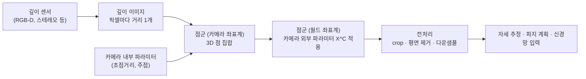

# 05. 점군 (Point Cloud)

> **이 문서의 성격**: 점군과 깊이 센싱의 일반 개념을 정리하고, MIT *Robotic Manipulation* 4장([Geometric Pose Estimation](https://manipulation.csail.mit.edu/pose.html))의 구성을 참고했습니다. 참고한 것은 페이지를 **요약해서 받은 내용**이며 원문 전문을 직접 읽은 것은 아닙니다. 수식·세부는 원문으로 확인하세요. 이 프로젝트에 적용하는 부분은 **→ 해석:** 으로 표시했습니다.
>
> 이어서 읽기: [자세 추정](06_pose_estimation.md) · 용어는 [용어집](../glossary/README.md)

## 점군이란

**점군(point cloud)은 3차원 공간의 점들의 집합**입니다. 각 점은 기준 좌표계에서의 `(x, y, z)`를 가지고, 색이나 법선 벡터가 붙기도 합니다. 깊이 카메라가 "물체 표면 중 카메라에 보이는 부분"을 샘플링한 결과라고 보면 됩니다.

- **보이는 표면만** 들어 있습니다. 물체의 뒷면, 바닥면은 없습니다.
- **점들 사이에 연결 정보가 없습니다.** 메시(mesh)처럼 면이 있는 것이 아니라 점의 무리입니다.
- **순서가 없는 집합**이라 점의 개수와 순서가 매번 다릅니다. 이것이 신경망 입력으로 쓸 때 별도 구조(PointNet 계열 등)가 필요한 이유입니다.

## 깊이 이미지에서 점군으로



### 1) 깊이 이미지 → 카메라 좌표계 점
깊이 이미지는 픽셀 `(u, v)`마다 거리 값 하나를 가진 이미지입니다. 핀홀 카메라 모델에서 픽셀과 깊이 `z`는 아래처럼 3D 점이 됩니다(일반적인 표준 식).

```
x = (u - cx) · z / fx
y = (v - cy) · z / fy
z = z
```

`fx, fy`(초점거리)와 `cx, cy`(주점)가 **내부 파라미터(intrinsics)** 입니다. Drake에서는 `CameraInfo`가 이 값을 담고 `DepthImageToPointCloud`가 변환을 수행합니다.

### 2) 카메라 좌표계 → 월드 좌표계
점군은 처음엔 **카메라 좌표계**에 있습니다. 로봇이 쓰려면 월드(또는 로봇 베이스) 좌표계로 옮겨야 하고, 이 변환이 카메라의 **외부 파라미터(extrinsics)** `X^C`입니다.

> MIT 노트가 강조하는 점: 외부 파라미터 보정이 부정확하면 작은 자세 오차도 **점군에 큰 왜곡**으로 나타납니다. 여러 카메라의 점군을 합칠 때 특히 그렇습니다.

### 3) 정보 손실에 주의
깊이 이미지를 점으로 바꾸면 "카메라에서 그 점까지의 **시선 방향 공간은 비어 있다**"는 정보(free space)가 사라집니다. 이 정보는 나중에 충돌·관통 제약에 쓸 수 있으니, **점군을 만들더라도 깊이 이미지를 같이 보관**하는 편이 좋습니다.

## 실제 센서의 문제들

| 문제 | 내용 | 영향 |
|---|---|---|
| **노이즈** | 오차가 단순한 가우시안이 아니고 조명·표면 각도·재질에 따라 달라짐 | 표면이 두껍거나 울퉁불퉁하게 찍힘 |
| **드롭아웃** | 반사·투명 표면, 물체 경계에서 값이 비거나 최대 거리로 보고됨 | 구멍, 가장자리 유령 점 |
| **가림(occlusion)** | 시선 방향만 보이므로 물체 뒷면, 다른 물체·로봇 손에 가려진 부분은 없음 | 부분 점군 → 자세 추정이 어려워짐 |
| **측정 범위** | 예: RealSense D415는 대략 0.3~1.5 m 범위로 알려져 있음 | 손목 카메라는 마지막 접근 구간에서 안 보일 수 있음 |
| **보정 오차** | 위 외부 파라미터 문제 | 다중 카메라 정합 불량 |

핵심은 **"가장 필요한 순간(접근·접촉)에 손과 물체가 시야를 가린다"** 는 점입니다.

## 전처리의 기본 도구

| 처리 | 하는 일 | 쓰는 때 |
|---|---|---|
| **Crop** | 관심 영역(작업대 위 상자 등)만 남김 | 가장 단순하고 효과가 큰 첫 단계 |
| **평면 제거** | 테이블·바닥 평면을 찾아 제거 (RANSAC 평면 피팅 등) | 물체만 분리할 때 |
| **다운샘플** | 격자(voxel)당 한 점만 남겨 점 수를 줄임 | 속도, 밀도 균일화 |
| **이상치 제거** | 이웃이 적은 외톨이 점 제거 | 드롭아웃·노이즈 정리 |
| **법선 추정** | 점 주변 평면을 피팅해 표면 방향 계산 | point-to-plane 정합 등 |
| **분할(segmentation)** | 물체별로 점군을 나눔 | 여러 물체가 있을 때. 요즘은 주로 신경망 사용 |

MIT 노트에 따르면 단순한 경우(알려진 테이블 기하를 빼는 방식, Drake `Crop`)는 이런 고전적 방법으로 충분하고, 다물체 장면에서는 다른 알고리즘(보통 신경망)으로 분할한 뒤 각 조각을 정합합니다.

## 기하 표현 비교

점군은 여러 표현 중 하나입니다. 용도에 따라 바꿔 씁니다.

| 표현 | 형태 | 장점 | 단점 |
|---|---|---|---|
| **깊이 이미지** | 2D 격자, 픽셀당 거리 | 센서 출력 그대로, free space 정보 보존, CNN 적용 쉬움 | 시점에 종속 |
| **점군** | 3D 점 집합 | 좌표계 합치기 쉬움, 기하 연산 직관적 | 순서 없음, 면·공간 정보 없음 |
| **메시** | 점 + 면 | 시뮬레이터·충돌 계산에 표준 | 센서로 바로 얻기 어려움 |
| **복셀 / 점유 격자** | 3D 격자의 점유 여부 | 충돌·경로 계획에 편리 | 메모리 부담, 해상도 한계 |
| **SDF (부호 거리장)** | 공간 각 점에서 표면까지 부호 있는 거리 | 거리 질의가 빠르고 미분 가능 | 만들거나 저장하는 비용 |
| **NeRF 등 신경 표현** | 학습된 연속 함수 | 사진 수준 재구성 | 학습·질의 비용 |

## 도구

- **Drake**: `RgbdSensor`(시뮬레이션 깊이 카메라), `CameraInfo`, `DepthImageToPointCloud`, `Crop`, MeshCat 시각화.
- **Open3D**: 점군 처리·정합·시각화의 사실상 표준 라이브러리로 널리 쓰임(MIT 노트도 사용). PCL은 노트에서 "개발이 중단됨"으로 언급.
- 시뮬레이션 렌더러는 기본이 빠른 OpenGL 계열이고, 학습 데이터용으로 물리 기반 레이트레이싱(Drake-Blender)을 쓸 수 있다고 소개됩니다.

## 이 프로젝트에서 (→ 해석)

- **지금(Phase B)**: 관측은 proprioception만이라 점군을 쓰지 않습니다. 물체 위치 오차는 `info`/`object_pos_noise`로 흉내냈습니다.
- **비전 도입 시**: 점군의 용도가 둘로 갈립니다.
  1. **물체 위치·자세 추정** → 도착 시점 동기화에 필요한 "손가락-물체 거리"를 줍니다. ([자세 추정](06_pose_estimation.md))
  2. **정책의 직접 입력**(깊이 이미지/점군). 용어집에 적었듯 RGB보다 sim-to-real 차이가 작다고 알려져 있습니다.
- 앞선 동기화 실험에서 **2 mm 수준의 비전 오차**를 넣어도 교란 변위가 0.05~0.20 mm로 유지됐습니다([촉각 없이 접촉을 다루는 법](03_touchless_grasping.md)). 점군에서 요구되는 정밀도 감을 잡는 참고가 됩니다. 단, 단일 시드의 단순화된 시뮬레이션 결과입니다.
- **가림 문제는 우리 과제의 핵심 제약**입니다. 접근 마지막에 손가락이 물체를 가리므로, 접촉 직전 위치는 "마지막으로 본 추정 + proprioception"으로 이어가야 할 가능성이 큽니다.

## 참고
- MIT Robotic Manipulation, 4장 *Geometric Pose Estimation* — [링크](https://manipulation.csail.mit.edu/pose.html) · [교재·강의 페이지](../reference/r3_courses.md#manipulation)
