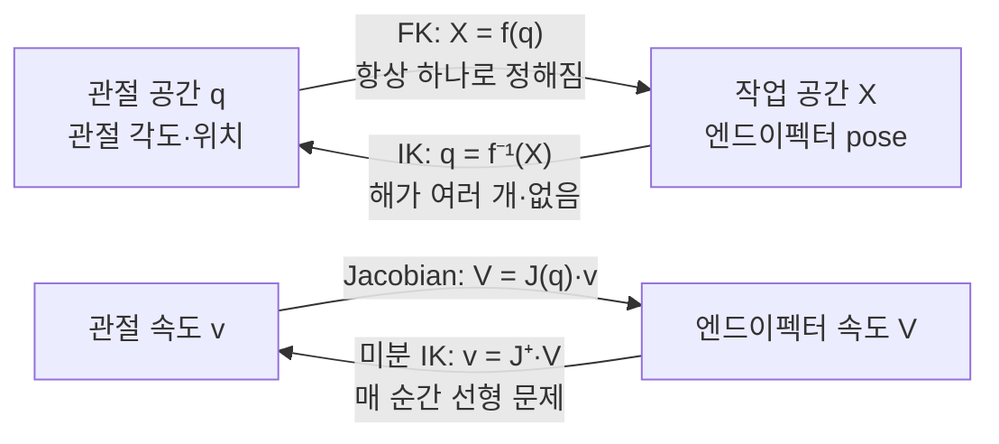

# 07. 순기구학(FK)과 역기구학(IK)

> **이 문서의 성격**: MIT *Robotic Manipulation* 3장 [Basic Pick and Place의 Kinematics 절](https://manipulation.csail.mit.edu/pick.html#kinematics)과 [`trajectories.html`](https://manipulation.csail.mit.edu/trajectories.html)을 참고했습니다. 두 페이지 모두 **요약본으로만** 확인했고 원문 전문을 읽지는 않았습니다. 참고로 `trajectories.html`의 실제 제목은 6장 *Motion Planning*이며, IK 최적화 정식화가 그 안에 있습니다. 두 페이지는 "작업 중인 노트"라 일부 절이 빈 자리(TODO)입니다. 2링크 팔 예제의 숫자는 직접 계산해 검증했습니다(`scripts/kinematics_2link.py`). 이 프로젝트에 적용하는 부분은 **→ 해석:** 으로 표시했습니다.
>
> 먼저 읽기: [Manipulation 기초](01_manipulation_basics.md) · 이어서: [자세 추정](06_pose_estimation.md) · [용어집](../glossary/README.md)

## 1. 큰 그림: 두 공간과 네 가지 사상

로봇을 다룰 때는 **관절 공간**(관절 각도 `q`)과 **작업 공간**(엔드이펙터의 위치·방향 `X`)을 오갑니다. 사상이 네 개 있습니다.



| 이름 | 방향 | 풀이의 성격 |
|---|---|---|
| **FK** (순기구학) | `q → X` | 계산하면 끝. 해가 정확히 하나 |
| **미분 기구학** | `v → V` | Jacobian `J(q)`를 곱하면 됨. 선형 |
| **미분 IK** | `V → v` | `J`의 역(의사역행렬)이 필요. 특이점에서 문제 |
| **IK** | `X → q` | 해가 여러 개거나 없을 수 있어 **어렵다** |

핵심 비대칭: **FK는 쉽고 IK는 어렵다.** 그래서 IK를 푸는 방법이 여러 가지로 갈립니다(5절).

## 2. 좌표와 표기

기구학은 좌표계를 헷갈리면 바로 버그가 됩니다. MIT 노트의 표기(monogram notation)는 **"어디서 잰, 무엇의 위치인가"** 를 기호에 그대로 적는 방식입니다.

| 기호 | 뜻 | 코드 이름 |
|---|---|---|
| `ᴮp^A_C` | 프레임 B에서 잰 A의 위치를 C 좌표로 표현 | `p_BA_C` |
| `ᴮR^A` | B에서 본 A의 방향(회전 행렬) | `R_BA` |
| `ᴮX^A` | B에서 본 A의 자세(위치+방향, 변환) | `X_BA` |

- **합성**: `X_AB · X_BC = X_AC`. 안쪽 문자가 서로 상쇄되게 읽으면 맞게 쓴 겁니다.
- **역변환**: `X_AB`의 역은 `X_BA`입니다. 회전 행렬은 `R⁻¹ = Rᵀ`이지만 **변환 `X`는 일반적으로 `X⁻¹ ≠ Xᵀ`** 입니다.
- 위치는 상대적인 양입니다. 두 점의 **상대 위치**만 말할 수 있고, 어느 프레임 좌표로 표현할지(expressed-in)는 별개입니다.

### 회전 표현은 하나로 다 해결되지 않는다
| 표현 | 약점 |
|---|---|
| 회전 행렬 | 9개 숫자(중복 많음) |
| Roll-Pitch-Yaw | pitch = ±90°에서 roll과 yaw가 구분 안 되는 **짐벌락** |
| 축-각(axis-angle) | 회전이 0일 때 축이 정의되지 않음 |
| 단위 쿼터니언 | 숫자 4개로 특이점 없이 표현하지만 `q`와 `−q`가 같은 회전(이중 덮개). 라이브러리마다 `wxyz`/`xyzw` 순서가 다름 |

## 3. 순기구학 (FK)

### 3.1 운동학 트리
로봇은 **트리**입니다. 각 링크(바디)는 부모에 관절로 연결되고, 부모에서 자식으로 가는 변환은 "고정 변환 · 관절 변환(q에 의존) · 고정 변환"의 곱입니다. 손끝 자세는 이 변환들을 베이스부터 차례로 곱해 구합니다.

```
X_PC(q) = X_P,JP · X_JP,JC(q) · X_JC,C      ← 가운데만 q에 의존, 양쪽은 고정
```

- 베이스를 월드에 고정(weld)하면 떠다니는 자유도가 사라지고, **관절이 곧 구속**입니다.
- 자유롭게 떠 있는 물체 하나의 `q`는 6이 아니라 **7개**입니다(단위 쿼터니언 4 + 위치 3). 이것이 6절의 `q̇`와 `v` 차이로 이어집니다.
- Drake: `MultibodyPlant`가 트리를 관리하고 `Context`가 `q`를 보관하며, `plant.EvalBodyPoseInWorld(context, body)`로 자세를 읽습니다.

### 3.2 2링크 팔 예제
링크 길이 1인 평면 2링크 팔의 FK는 삼각함수 두 줄입니다.

<figure class="hf-fig"><svg class="hf" viewBox="0 0 690 250" role="img" aria-label="2링크 팔의 순기구학"><polyline points="120.0,215.0 206.0,154.8 178.8,53.4" class="hf-link"/><circle cx="120.0" cy="215.0" r="6" class="hf-joint"/><circle cx="206.0" cy="154.8" r="5" class="hf-joint"/><line x1="90" y1="215" x2="380" y2="215" class="hf-axis"/><path d="M160.0,215.0 A40,40 0 0 0 152.8,192.1" class="hf-arc"/><path d="M230.6,137.6 A30,30 0 0 0 198.2,125.8" class="hf-arc"/><line x1="206.0" y1="154.8" x2="263.4" y2="114.6" class="hf-axis"/><text x="168" y="207" class="hf-t">q₀</text><text x="242.01096465034414" y="130.77447418314017" class="hf-t">q₁</text><text x="145" y="179" class="hf-t">l₁</text><text x="204" y="102" class="hf-t">l₂</text><circle cx="178.8" cy="53.4" r="7" class="hf-pt k-ee"/><text x="191" y="57" class="hf-h">엔드이펙터 p</text><text x="114" y="239" text-anchor="end" class="hf-t">베이스</text><text x="430" y="70" class="hf-h">순기구학 (FK)</text><text x="430" y="98" class="hf-t">p = f(q)</text><text x="430" y="119" class="hf-t">x = l₁·cos q₀ + l₂·cos(q₀+q₁)</text><text x="430" y="140" class="hf-t">y = l₁·sin q₀ + l₂·sin(q₀+q₁)</text><text x="430" y="161" class="hf-t"></text><text x="430" y="182" class="hf-t">관절 각도 q (2개)</text><text x="430" y="203" class="hf-t">   → 엔드이펙터 위치 p (2개)</text><text x="430" y="224" class="hf-t">항상 해가 하나: 그냥 계산하면 됨</text></svg><figcaption>그림 1. 평면 2링크 팔의 FK. 관절 각도 두 개(q₀, q₁)로 엔드이펙터 위치가 하나로 결정된다.</figcaption></figure>

## 4. 미분 기구학과 Jacobian

FK를 `q`로 미분하면 **"관절을 조금 움직였을 때 손끝이 얼마나 움직이는가"** 를 나타내는 **Jacobian**이 나옵니다.

```
V = J(q) · v        V = [ω; v_tip]  (공간 속도: 각속도 3 + 선속도 3)
```

2링크 팔(단위 링크)의 Jacobian은 다음과 같습니다.

```
J(q) = [ −sin q₀ − sin(q₀+q₁)    −sin(q₀+q₁) ]
       [  cos q₀ + cos(q₀+q₁)     cos(q₀+q₁) ]      det J = sin q₁
```

### 주의할 점 (노트가 강조하는 부분)
- **공간 속도(twist) `V = [ω; v]`** 는 각속도와 선속도를 묶은 6차원 벡터입니다. 각속도는 roll·pitch·yaw의 시간 미분이 **아닙니다**.
- **`q̇`(위치의 미분)와 `v`(일반화 속도)는 차원이 다를 수 있습니다.** 떠 있는 물체는 `q`가 7차원이지만 `v`는 6차원입니다. 변환 함수 `plant.MapQDotToVelocity`, `plant.MapVelocityToQDot`를 써야 하며, 노트도 "써야 한다는 걸 잊지 말라"고 경고합니다.
- Drake의 Jacobian은 기하학적 형태입니다: `CalcJacobianAngularVelocity`, `CalcJacobianTranslationalVelocity`, `CalcJacobianSpatialVelocity`. 7자유도 iiwa를 월드에 고정하면 손끝 공간 속도 Jacobian은 **6×7**입니다.
- 해석적 Jacobian(`∂f/∂q`)은 자동미분으로도 얻을 수 있지만 훨씬 비효율적이라고 소개됩니다.

## 5. 역기구학 (IK)

"원하는 자세 `X`를 만드는 `q`는?"에는 접근이 세 가지 있습니다.

### 5.1 해석해 (닫힌 해)
FK가 삼각함수로 구조화되어 있어서 6자유도 팔이 6D 자세를 맞추는 경우에는 **닫힌 해**가 있습니다(IKFast 등). 7자유도는 여유 자유도를 **샘플링**해서 풉니다. 빠르지만 **부등식 제약(관절 한계, 충돌)을 표현하지 못합니다.**

### 5.2 2링크 팔로 보는 IK: 해가 둘
같은 목표를 만드는 `q`가 둘입니다(팔꿈치 위/아래). 목표가 도달 범위 밖이면 해가 없고, 경계에서는 해가 하나입니다.

<figure class="hf-fig"><svg class="hf" viewBox="0 0 690 250" role="img" aria-label="같은 목표에 대한 IK의 두 해"><path d="M-110,215 A200,200 0 0 1 290,215" class="hf-ws"/><line x1="60" y1="215" x2="320" y2="215" class="hf-axis"/><text x="284" y="207" text-anchor="end" class="hf-t">도달 한계 (l₁+l₂)</text><polyline points="90.0,215.0 111.6,117.4 210.0,135.0" class="hf-link"/><circle cx="90.0" cy="215.0" r="6" class="hf-joint"/><circle cx="111.6" cy="117.4" r="5" class="hf-joint"/><polyline points="90.0,215.0 188.4,232.6 210.0,135.0" class="hf-link alt"/><circle cx="90.0" cy="215.0" r="6" class="hf-joint"/><circle cx="188.4" cy="232.6" r="5" class="hf-joint"/><circle cx="210.0" cy="135.0" r="8" class="hf-target"/><text x="224" y="129" class="hf-h">목표 p</text><text x="84" y="239" text-anchor="end" class="hf-t">베이스</text><text x="430" y="62" class="hf-h">역기구학 (IK): 해가 둘</text><text x="430" y="90" class="hf-key a">■ 팔꿈치 위 해: q = (78°, -88°)</text><text x="430" y="112" class="hf-key b">■ 팔꿈치 아래 해: q = (-10°, 88°)</text><text x="430" y="134" class="hf-t"></text><text x="430" y="156" class="hf-t">같은 p를 만드는 q가 2개 (자유도가 같아도)</text><text x="430" y="178" class="hf-t">범위 밖 p → 해 없음, 경계 p → 해 1개</text><text x="430" y="200" class="hf-t">7자유도 팔 → 해가 무한히 많음 (여유 자유도)</text></svg><figcaption>그림 2. 목표 p=(1.2, 0.8)에 대한 두 IK 해. 자유도가 같아도 해가 2개일 수 있고, 7자유도 팔에서는 무한히 많아진다.</figcaption></figure>

### 5.3 최적화로 푸는 IK
노트가 제시하는 일반 정식화는 **"해가 여러 개면 가장 편안한 자세에 가까운 것을 고르자"** 입니다.

```
min_q  ‖ q − q₀ ‖²          q₀ : 기준 자세 ("편안한" 관절 중심 자세)
s.t.   X_G = f_kin(q)        손끝 자세 조건 (위치·방향·일부만 지정 가능)
       q_min ≤ q ≤ q_max     관절 한계
       충돌 회피 (최소 거리 ≥ 0), 그 밖의 제약 …
```

이 형태의 장점은 **풍부한 제약을 자연스럽게 넣을 수 있다**는 것입니다. 노트의 조언을 요약하면 다음과 같습니다.

- 꼭 지켜야 하는 요구는 **비용이 아니라 제약**으로 둡니다. 비용에 벌점으로 넣으면 가중치 튜닝이 끝없이 늘어납니다.
- **제약은 최소로** 씁니다. 실행 가능 영역이 넓을수록 풀기 쉽습니다. 방향이 필요 없는 작업이면 방향을 제약하지 않습니다. (예: 원통을 쥘 때 손가락 두 점을 원통 축 위에 두는 제약만 걸면 축 둘레 회전은 자유로움)
- **국소해 문제**: SNOPT 같은 비선형 솔버는 실전에서 잘 돌지만 보장은 없고, 해가 존재해도 "실행 불가"로 끝날 수 있습니다. 충돌 제약이 가장 까다로운 비볼록 부분입니다. 초기값을 잘 잡거나, 충돌 제약 없이 먼저 풀고 그 해로 다시 시작(warm-start)하는 방법이 소개됩니다.
- **전역 IK**: Drake `GlobalInverseKinematics`가 혼합정수 볼록 최적화로 전역 해를 찾지만 수 초가 걸려, 오프라인(학습 데이터 생성, 작업 공간 분석)에 쓰는 것이 일반적이라고 소개됩니다.

Drake: `InverseKinematics` 클래스로 제약을 `MathematicalProgram`에 추가해 풉니다. 이 접근은 파지 후보를 평가할 때도 쓰입니다. 후보 자세마다 IK를 풀어 **불가능하면 버리고**, 가능하면 관절 중심 비용으로 점수를 매기는 식입니다.

### 5.4 미분 IK: 한 걸음씩 가는 방법
위치 IK 대신 **속도 수준**에서 푸는 방법입니다. 매 순간 `V = J·v`를 `v`에 대해 풉니다.

```
v = J⁺ · V_d            (의사역행렬)
```

- `J`가 정방·정칙이면 정확한 해, 해가 많으면 **최소 노름 해**, 해가 없으면 **최소제곱 해**를 줍니다.
- 그러나 의사역행렬은 **특이점 근처에서 폭주**하고 **관절 한계를 모릅니다**. 그래서 같은 문제를 **QP(이차계획)** 로 써서 제약을 넣습니다.

```
min_v  ‖ J·v − V_d ‖²
s.t.   v_min ≤ v ≤ v_max                     속도 한계
       q_min ≤ q + h·v ≤ q_max               위치 한계 (다음 스텝 예측)
       dv_min ≤ (v − v_현재)/h ≤ dv_max       가속도 한계
```


**관절 중심화(joint centering)와 영공간**: 7자유도 팔은 손끝 목표(6)보다 자유도가 많아서 **손끝을 움직이지 않고 관절만 움직일 여유**가 있습니다. 이 여유를 영공간(null space)이라 하고, 영공간 투영 `P(q) = I − J⁺J`로 "손끝에 영향 없는 움직임"만 골라 보조 목표(관절을 중앙 쪽으로 당기기)를 줍니다. 노트는 보조 항에 작은 가중치(≈0.01)를 줄 것을 제안합니다. 너무 작으면 수치가 나빠집니다.

### 5.5 IK와 미분 IK는 어떻게 다른가
| 관점 | IK (위치 수준) | 미분 IK (속도 수준) |
|---|---|---|
| 푸는 것 | 목표 자세에 대한 **전역적** 비선형 문제 | 매 순간의 **선형** 문제 (전체 문제의 한 스텝) |
| 장점 | 멀리 떨어진 목표도 한 번에, 장애물 반대편 해도 가능 | 연속적이고 부드러운 **점진적 움직임**에 아주 잘 맞음 |
| 약점 | 성공 보장이 없고 비용이 조금 바뀌어도 `Δq`가 크게 튈 수 있음 | 국소적이라 장애물 건너편 같은 다른 해로는 못 감 |
| 잘 맞는 때 | 키프레임 자세 계산, 파지 후보 검사, 궤적 시작/끝 | 텔레옵, 부드러운 end-effector 경로 추종 |

## 6. 특이점 (Singularity)

`J`의 랭크가 부족한(`rank J < 6`, 2링크 예제에서는 `det J = sin q₁ = 0`) 자세를 **특이점**이라 합니다. 그 자세에서는 **어떤 방향의 손끝 속도는 관절을 아무리 움직여도 만들 수 없습니다.**

<figure class="hf-fig"><svg class="hf" viewBox="0 0 690 285" role="img" aria-label="조작성 타원과 특이점"><ellipse cx="76.1" cy="119.1" rx="50.6" ry="22.5" transform="rotate(-171.8 76.1 119.1)" class="hf-ell"/><polyline points="50.0,175.0 96.4,162.6 76.1,119.1" class="hf-link"/><circle cx="50.0" cy="175.0" r="6" class="hf-joint"/><circle cx="96.4" cy="162.6" r="5" class="hf-joint"/><circle cx="76.1" cy="119.1" r="5.5" class="hf-pt k-ee"/><text x="115" y="228" text-anchor="middle" class="hf-h">q₁ = 100°</text><text x="115" y="247" text-anchor="middle" class="hf-t">σ = 1.49, 0.66</text><text x="115" y="266" text-anchor="middle" class="hf-t">넓고 둥긂: 어느 방향이든 잘 움직임</text><ellipse cx="350.4" cy="121.0" rx="70.5" ry="11.6" transform="rotate(-132.4 350.4 121.0)" class="hf-ell"/><polyline points="280.0,175.0 326.4,162.6 350.4,121.0" class="hf-link"/><circle cx="280.0" cy="175.0" r="6" class="hf-joint"/><circle cx="326.4" cy="162.6" r="5" class="hf-joint"/><circle cx="350.4" cy="121.0" r="5.5" class="hf-pt k-ee"/><text x="345" y="228" text-anchor="middle" class="hf-h">q₁ = 45°</text><text x="345" y="247" text-anchor="middle" class="hf-t">σ = 2.07, 0.34</text><text x="345" y="266" text-anchor="middle" class="hf-t">길쭉해짐: 방향마다 속도 차이</text><ellipse cx="600.5" cy="143.8" rx="75.8" ry="2.1" transform="rotate(-109.8 600.5 143.8)" class="hf-ell"/><polyline points="510.0,175.0 556.4,162.6 600.5,143.8" class="hf-link"/><circle cx="510.0" cy="175.0" r="6" class="hf-joint"/><circle cx="556.4" cy="162.6" r="5" class="hf-joint"/><circle cx="600.5" cy="143.8" r="5.5" class="hf-pt k-ee"/><text x="575" y="228" text-anchor="middle" class="hf-h">q₁ = 8°</text><text x="575" y="247" text-anchor="middle" class="hf-t">σ = 2.23, 0.06</text><text x="575" y="266" text-anchor="middle" class="hf-t">거의 납작: 팔 축 방향 속도가 안 나옴</text></svg><figcaption>그림 3. 조작성 타원(손끝에서 단위 관절 속도로 낼 수 있는 속도 범위). 타원이 납작해질수록 한 방향 속도를 내기 어려워진다. σ는 Jacobian의 특이값.</figcaption></figure>

팔을 거의 다 펴면(`q₁ → 0`) 팔 축 방향으로는 손끝이 거의 움직이지 못합니다. 같은 속도 `0.1`을 팔 축 방향과 축에 수직 방향으로 요구했을 때 의사역행렬이 내놓는 관절 속도 크기는 다음과 같습니다(`q₀ = 0`).

| `q₁` (rad) | `det J` | 가장 작은 특이값 | 축 방향 `V = 0.1`에 필요한 `‖v‖` | 축에 수직 `V = 0.1`에 필요한 `‖v‖` |
|---|---|---|---|---|
| 1.571 (90°) | 1.000 | 0.618 | 0.100 | 0.141 |
| 0.5 | 0.479 | 0.221 | 0.432 | 0.141 |
| 0.3 | 0.296 | 0.134 | 0.736 | 0.141 |
| 0.1 | 0.100 | 0.045 | 2.233 | 0.141 |
| 0.03 | 0.030 | 0.013 | 7.453 | 0.141 |

- **막힌 방향**(팔 축)의 요구 속도는 `1/sin q₁`처럼 **폭증**하고, 수직 방향은 변하지 않습니다.
- 그래서 노트는 **가장 작은 특이값**을 실용적 지표로 쓰고, 엔드이펙터 제어에서는 특이점 근처를 **피하라**고 조언합니다.
- 노트가 짚는 미묘한 점: 특이점에서 손끝이 +x로 못 가는 것은 **순간 속도**에 관한 이야기이고, 가속하면서 반대로 돌아 나올 수는 있습니다. 또 의사역행렬은 일반적으로 **적분 가능하지 않아서**, 작업 공간에서 닫힌 경로를 그려도 관절은 처음 값으로 돌아오지 않을 수 있습니다.

## 7. 자주 하는 실수

| 함정 | 증상 | 대응 |
|---|---|---|
| 프레임 혼동 | 물체가 엉뚱한 곳으로 | 표기법(`X_AB`)으로 안쪽 문자 상쇄 확인 |
| `q̇` vs `v` 혼동 | 부유 물체 속도가 이상함 | `MapQDotToVelocity`·`MapVelocityToQDot` 사용 |
| 쿼터니언 순서 | 방향이 뒤틀림 | 라이브러리별 `wxyz`/`xyzw` 명시 |
| RPY 짐벌락 | 특정 자세에서 각도가 튐 | 회전 행렬/쿼터니언 사용 |
| 특이점 근처 의사역행렬 | 관절 속도 폭주 | QP로 속도 한계, 특이점 회피 |
| IK 국소해·초기값 | "해 없음"인데 실제로는 있음 | 초기값 개선, 제약 완화 후 warm-start |
| 제약 과다 | 해가 안 나옴 | 필요한 제약만 |
| 목표 자세가 해 하나인 줄 앎 | 팔꿈치 반대 자세로 튐 | 기준 자세 `q₀`로 해 선택 |

## 8. 이 프로젝트에서 (→ 해석)

- **지금(Phase B)**: 손가락 3개가 각각 반지름 방향 1자유도 슬라이더라 FK는 "관절 위치 = 손끝 위치", Jacobian은 1입니다. 그래서 IK 문제가 사실상 없고, 액션을 **손끝(작업 공간) 반경 목표**로 직접 주고 있습니다.
- **LEAP Hand로 확장하면** 손가락 하나가 여러 관절이라 FK·Jacobian이 필요해집니다. 쓰임새는 세 가지로 보입니다.
  1. **손끝-물체 거리**: 도착 시점 동기화([촉각 없이 접촉을 다루는 법](03_touchless_grasping.md))에는 관절 값이 아니라 **손끝 위치**가 필요하고, 이것은 proprioception에 FK를 적용해 얻습니다. 접촉까지 시간 ≈ 거리 ÷ 손끝 속도의 손끝 속도도 `V = J·v`로 계산합니다.
  2. **손끝 속도 명령 → 관절 속도**: 손가락마다 미분 IK(QP)를 풉니다. 손가락 관절이 손끝 위치 자유도(3)보다 많으면(예: 4관절) **영공간 여유**가 생기고, 관절 한계 회피에 활용할 수 있습니다.
  3. **접촉 힘 ↔ 관절 토크**: 일반적으로 `τ = Jᵀ f` 관계로 연결됩니다. 이는 이 두 페이지에서 확인한 내용이 아니라 일반 지식이므로 별도 자료로 확인이 필요합니다.
- **특이점**은 손가락이 완전히 펴졌을 때 특히 조심할 부분이고, 접근 시작 자세를 완전 신전에서 떨어뜨려 두는 것이 안전합니다(직접 검증한 것은 아님).
- 파지 후보를 만들 때는 [대척 파지와 Hessian](08_antipodal_hessian.md)의 후보에 대해 **IK로 도달 가능성**을 걸러내는 단계가 이어질 수 있습니다.
- 작업 계층([FSM/BT](04_fsm_and_behavior_tree.md))에서는 IK 실패를 Condition 노드로 받아 대안 분기를 타게 하는 구성이 자연스럽습니다.

## 참고
- MIT Robotic Manipulation, 3장 [Basic Pick and Place — Kinematics](https://manipulation.csail.mit.edu/pick.html#kinematics), 6장 [Motion Planning (trajectories.html)](https://manipulation.csail.mit.edu/trajectories.html) · [교재·강의 페이지](../reference/r3_courses.md#manipulation)
- 위 노트가 언급하지만 이 문서에서 다루지 않은 것: 키프레임 궤적 보간(`PiecewisePose` 등), B-spline 기반 기구학 궤적 최적화, RRT/PRM, GCS, 시간 최적 경로 매개변수화(TOPP). 모션 플래닝으로 이어지는 주제이며 이후 문서로 분리할 수 있습니다.
- 수치 검증과 그림 생성: `scripts/kinematics_2link.py` (`--figs DIR`로 SVG 재생성).
