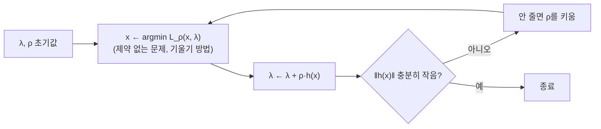

# 15. B-스플라인과 증강 라그랑지안

> **이 문서의 성격**: MIT *Robotic Manipulation* 6장 [Motion Planning (`trajectories.html`)](https://manipulation.csail.mit.edu/trajectories.html)의 *Kinematic trajectory optimization* 부분을 참고했습니다. 페이지 전체 텍스트를 내려받아 해당 절들(Trajectory parameterizations, Optimization algorithms 등)을 읽었습니다. 다만 **원문이 이 두 주제를 짧게만 다룹니다.** B-스플라인 절에는 수식 대신 "여기에 B-spline 수학을 쓸 것"이라는 메모가 남아 있고, 증강 라그랑지안은 한 문단입니다. 그래서 이 문서는 두 갈래로 나뉩니다.
> - **(원문)**: 노트에 적힌 내용. 인용·요약했습니다.
> - **(일반 지식)**: 노트에 없어서 표준 교재 수준의 수식으로 보충한 부분. 수치는 `scripts/bspline_al.py`로 직접 계산해 확인했지만, 특정 논문(Toussaint 2014 등)의 정식화와 같은지는 **확인하지 않았습니다.**
>
> 먼저 읽기: [FK와 IK](07_fk_and_ik.md)(특히 5.3 최적화로 푸는 IK) · [용어집](../glossary/README.md)

## 1. 큰 그림: 이 둘이 어디에 쓰이나

IK는 자세 하나에 대한 관절 각도 `q`를 구합니다. **기구학 궤적 최적화**는 한 걸음 더 나가 **시간에 따른 궤적 `q(t)` 전체를 한 번에** 최적화합니다(원문). 원문이 드는 가장 단순한 꼴은 이렇습니다.

$$
\min_{\alpha, T}\; T \quad \text{s.t.}\quad X^{G_{start}} = f_{kin}(q_\alpha(0)),\;\; X^{G_{goal}} = f_{kin}(q_\alpha(T)),\;\; |\dot q_\alpha(t)| \le v_{max}\;\;\forall t
$$

"시작에서 목표까지 가장 빨리 가는 궤적을 찾아라"로 읽습니다. 속도 제한 줄이 로봇이 순간이동하지 못하게 하는 유일한 장치입니다. 여기서 두 질문이 생깁니다.

| 질문 | 이 문서의 답 |
|---|---|
| 궤적 `q_α(t)`를 **어떤 모양의 함수**로 쓰고 `α`를 무엇으로 둘까? | **B-스플라인**(2절). `α` = 제어점 |
| 제약이 붙은 비볼록 문제를 **어떤 알고리즘**으로 풀까? | SNOPT 같은 SQP, 또는 **증강 라그랑지안**(3절) |

두 선택은 독립입니다. B-스플라인 궤적을 SQP로 풀 수도, 증강 라그랑지안으로 풀 수도 있습니다.

## 2. B-스플라인

### 2.1 한 줄 정의 (일반 지식)

곡선을 **제어점의 가중합**으로 씁니다. 가중치가 시간(매개변수 `s`)에 따라 변하는 함수 `B_i(s)`(기저)입니다.

$$
r(s) = \sum_{i=0}^{n-1} P_i\, B_{i,k}(s), \qquad s\in[0,1]
$$

| 용어 | 뜻 |
|---|---|
| 제어점 `P_i` | 곡선을 결정하는 점(로봇 관절 공간이면 `q` 값). 최적화 변수 `α`가 이것 |
| 차수 `k` | 다항식의 차수. 기구학 궤적에는 3차(`k = 3`)가 흔합니다(추정, 원문은 차수를 못 박지 않음) |
| 매듭 `t_j` | 다항식 조각이 이어지는 `s` 값. 제어점 `n`개, 차수 `k`이면 매듭은 `n + k + 1`개 |
| 기저 `B_(i,k)` | 제어점 `P_i`의 영향력을 정하는 조각별 다항식 |

원문의 "B"에 대한 한마디: **B는 basis(기저)의 약자입니다**("농담이 아님"). Bézier 곡선과 가깝지만, 원문은 "Bézier 스플라인은 약간 다르다"고 합니다. (일반 지식: 매듭 사이 조각이 하나뿐인 B-스플라인이 Bézier 곡선입니다. 직접 확인하지는 않았습니다.)

### 2.2 기저 함수

기저는 **Cox–de Boor 점화식**으로 만듭니다(일반 지식).

$$
B_{i,0}(s)=\begin{cases}1 & t_i\le s<t_{i+1}\\0&\text{otherwise}\end{cases},\qquad
B_{i,k}(s)=\frac{s-t_i}{t_{i+k}-t_i}B_{i,k-1}(s)+\frac{t_{i+k+1}-s}{t_{i+k+1}-t_{i+1}}B_{i+1,k-1}(s)
$$

<figure class="hf-fig"><svg class="hf" viewBox="0 0 690 250" role="img" aria-label="3차 B-스플라인의 기저 함수"><line x1="50" y1="190" x2="650" y2="190" class="hf-axis"/><line x1="50" y1="40" x2="650" y2="40" class="hf-axis"/><text x="42" y="44" text-anchor="end" class="hf-t">1</text><text x="42" y="194" text-anchor="end" class="hf-t">0</text><line x1="50.0" y1="190" x2="50.0" y2="195" style="stroke:var(--kit-muted);stroke-width:1.3"/><text x="50.0" y="210" text-anchor="middle" class="hf-t">0.00</text><line x1="250.0" y1="190" x2="250.0" y2="195" style="stroke:var(--kit-muted);stroke-width:1.3"/><text x="250.0" y="210" text-anchor="middle" class="hf-t">0.33</text><line x1="450.0" y1="190" x2="450.0" y2="195" style="stroke:var(--kit-muted);stroke-width:1.3"/><text x="450.0" y="210" text-anchor="middle" class="hf-t">0.67</text><line x1="650.0" y1="190" x2="650.0" y2="195" style="stroke:var(--kit-muted);stroke-width:1.3"/><text x="650.0" y="210" text-anchor="middle" class="hf-t">1.00</text><polyline points="50.0,40.0 52.0,44.5 54.0,48.8 56.0,53.1 58.0,57.3 60.0,61.4 62.0,65.4 64.0,69.3 66.0,73.2 68.0,77.0 70.0,80.6 72.0,84.3 74.0,87.8 76.0,91.2 78.0,94.6 80.0,97.9 82.0,101.1 84.0,104.2 86.0,107.3 88.0,110.3 90.0,113.2 92.0,116.0 94.0,118.8 96.0,121.5 98.0,124.2 100.0,126.7 102.0,129.2 104.0,131.6 106.0,134.0 108.0,136.3 110.0,138.6 112.0,140.7 114.0,142.8 116.0,144.9 118.0,146.9 120.0,148.8 122.0,150.7 124.0,152.5 126.0,154.3 128.0,156.0 130.0,157.6 132.0,159.2 134.0,160.7 136.0,162.2 138.0,163.7 140.0,165.0 142.0,166.4 144.0,167.7 146.0,168.9 148.0,170.1 150.0,171.2 152.0,172.4 154.0,173.4 156.0,174.4 158.0,175.4 160.0,176.3 162.0,177.2 164.0,178.1 166.0,178.9 168.0,179.7 170.0,180.4 172.0,181.1 174.0,181.8 176.0,182.4 178.0,183.0 180.0,183.6 182.0,184.1 184.0,184.6 186.0,185.1 188.0,185.5 190.0,185.9 192.0,186.3 194.0,186.7 196.0,187.0 198.0,187.4 200.0,187.7 202.0,187.9 204.0,188.2 206.0,188.4 208.0,188.6 210.0,188.8 212.0,189.0 214.0,189.1 216.0,189.3 218.0,189.4 220.0,189.5 222.0,189.6 224.0,189.7 226.0,189.7 228.0,189.8 230.0,189.8 232.0,189.9 234.0,189.9 236.0,189.9 238.0,190.0 240.0,190.0 242.0,190.0 244.0,190.0 246.0,190.0 248.0,190.0 250.0,190.0 252.0,190.0 254.0,190.0 256.0,190.0 258.0,190.0 260.0,190.0 262.0,190.0 264.0,190.0 266.0,190.0 268.0,190.0 270.0,190.0 272.0,190.0 274.0,190.0 276.0,190.0 278.0,190.0 280.0,190.0 282.0,190.0 284.0,190.0 286.0,190.0 288.0,190.0 290.0,190.0 292.0,190.0 294.0,190.0 296.0,190.0 298.0,190.0 300.0,190.0 302.0,190.0 304.0,190.0 306.0,190.0 308.0,190.0 310.0,190.0 312.0,190.0 314.0,190.0 316.0,190.0 318.0,190.0 320.0,190.0 322.0,190.0 324.0,190.0 326.0,190.0 328.0,190.0 330.0,190.0 332.0,190.0 334.0,190.0 336.0,190.0 338.0,190.0 340.0,190.0 342.0,190.0 344.0,190.0 346.0,190.0 348.0,190.0 350.0,190.0 352.0,190.0 354.0,190.0 356.0,190.0 358.0,190.0 360.0,190.0 362.0,190.0 364.0,190.0 366.0,190.0 368.0,190.0 370.0,190.0 372.0,190.0 374.0,190.0 376.0,190.0 378.0,190.0 380.0,190.0 382.0,190.0 384.0,190.0 386.0,190.0 388.0,190.0 390.0,190.0 392.0,190.0 394.0,190.0 396.0,190.0 398.0,190.0 400.0,190.0 402.0,190.0 404.0,190.0 406.0,190.0 408.0,190.0 410.0,190.0 412.0,190.0 414.0,190.0 416.0,190.0 418.0,190.0 420.0,190.0 422.0,190.0 424.0,190.0 426.0,190.0 428.0,190.0 430.0,190.0 432.0,190.0 434.0,190.0 436.0,190.0 438.0,190.0 440.0,190.0 442.0,190.0 444.0,190.0 446.0,190.0 448.0,190.0 450.0,190.0 452.0,190.0 454.0,190.0 456.0,190.0 458.0,190.0 460.0,190.0 462.0,190.0 464.0,190.0 466.0,190.0 468.0,190.0 470.0,190.0 472.0,190.0 474.0,190.0 476.0,190.0 478.0,190.0 480.0,190.0 482.0,190.0 484.0,190.0 486.0,190.0 488.0,190.0 490.0,190.0 492.0,190.0 494.0,190.0 496.0,190.0 498.0,190.0 500.0,190.0 502.0,190.0 504.0,190.0 506.0,190.0 508.0,190.0 510.0,190.0 512.0,190.0 514.0,190.0 516.0,190.0 518.0,190.0 520.0,190.0 522.0,190.0 524.0,190.0 526.0,190.0 528.0,190.0 530.0,190.0 532.0,190.0 534.0,190.0 536.0,190.0 538.0,190.0 540.0,190.0 542.0,190.0 544.0,190.0 546.0,190.0 548.0,190.0 550.0,190.0 552.0,190.0 554.0,190.0 556.0,190.0 558.0,190.0 560.0,190.0 562.0,190.0 564.0,190.0 566.0,190.0 568.0,190.0 570.0,190.0 572.0,190.0 574.0,190.0 576.0,190.0 578.0,190.0 580.0,190.0 582.0,190.0 584.0,190.0 586.0,190.0 588.0,190.0 590.0,190.0 592.0,190.0 594.0,190.0 596.0,190.0 598.0,190.0 600.0,190.0 602.0,190.0 604.0,190.0 606.0,190.0 608.0,190.0 610.0,190.0 612.0,190.0 614.0,190.0 616.0,190.0 618.0,190.0 620.0,190.0 622.0,190.0 624.0,190.0 626.0,190.0 628.0,190.0 630.0,190.0 632.0,190.0 634.0,190.0 636.0,190.0 638.0,190.0 640.0,190.0 642.0,190.0 644.0,190.0 646.0,190.0 648.0,190.0 650.0,190.0" style="fill:none;stroke:var(--kit-accent);stroke-width:2.4"/><text x="50" y="34" text-anchor="middle" class="hf-t" style="fill:var(--kit-accent)">B0</text><polyline points="50.0,190.0 52.0,185.6 54.0,181.3 56.0,177.1 58.0,173.1 60.0,169.2 62.0,165.4 64.0,161.7 66.0,158.2 68.0,154.8 70.0,151.5 72.0,148.3 74.0,145.3 76.0,142.3 78.0,139.5 80.0,136.8 82.0,134.2 84.0,131.7 86.0,129.3 88.0,127.1 90.0,124.9 92.0,122.8 94.0,120.9 96.0,119.0 98.0,117.3 100.0,115.6 102.0,114.0 104.0,112.5 106.0,111.2 108.0,109.9 110.0,108.7 112.0,107.5 114.0,106.5 116.0,105.6 118.0,104.7 120.0,103.9 122.0,103.2 124.0,102.6 126.0,102.1 128.0,101.6 130.0,101.2 132.0,100.9 134.0,100.6 136.0,100.4 138.0,100.3 140.0,100.3 142.0,100.3 144.0,100.4 146.0,100.5 148.0,100.7 150.0,100.9 152.0,101.2 154.0,101.6 156.0,102.0 158.0,102.5 160.0,103.0 162.0,103.6 164.0,104.2 166.0,104.9 168.0,105.6 170.0,106.3 172.0,107.1 174.0,107.9 176.0,108.8 178.0,109.7 180.0,110.6 182.0,111.6 184.0,112.6 186.0,113.6 188.0,114.6 190.0,115.7 192.0,116.8 194.0,117.9 196.0,119.1 198.0,120.3 200.0,121.4 202.0,122.6 204.0,123.9 206.0,125.1 208.0,126.3 210.0,127.6 212.0,128.9 214.0,130.1 216.0,131.4 218.0,132.7 220.0,134.0 222.0,135.3 224.0,136.6 226.0,137.8 228.0,139.1 230.0,140.4 232.0,141.7 234.0,142.9 236.0,144.2 238.0,145.4 240.0,146.6 242.0,147.8 244.0,149.0 246.0,150.2 248.0,151.4 250.0,152.5 252.0,153.6 254.0,154.7 256.0,155.8 258.0,156.8 260.0,157.8 262.0,158.9 264.0,159.8 266.0,160.8 268.0,161.7 270.0,162.7 272.0,163.6 274.0,164.4 276.0,165.3 278.0,166.1 280.0,167.0 282.0,167.8 284.0,168.6 286.0,169.3 288.0,170.1 290.0,170.8 292.0,171.5 294.0,172.2 296.0,172.9 298.0,173.5 300.0,174.2 302.0,174.8 304.0,175.4 306.0,176.0 308.0,176.6 310.0,177.1 312.0,177.7 314.0,178.2 316.0,178.7 318.0,179.2 320.0,179.7 322.0,180.2 324.0,180.6 326.0,181.1 328.0,181.5 330.0,181.9 332.0,182.3 334.0,182.7 336.0,183.1 338.0,183.4 340.0,183.8 342.0,184.1 344.0,184.4 346.0,184.7 348.0,185.0 350.0,185.3 352.0,185.6 354.0,185.9 356.0,186.1 358.0,186.3 360.0,186.6 362.0,186.8 364.0,187.0 366.0,187.2 368.0,187.4 370.0,187.6 372.0,187.8 374.0,187.9 376.0,188.1 378.0,188.3 380.0,188.4 382.0,188.5 384.0,188.7 386.0,188.8 388.0,188.9 390.0,189.0 392.0,189.1 394.0,189.2 396.0,189.3 398.0,189.3 400.0,189.4 402.0,189.5 404.0,189.5 406.0,189.6 408.0,189.7 410.0,189.7 412.0,189.7 414.0,189.8 416.0,189.8 418.0,189.8 420.0,189.9 422.0,189.9 424.0,189.9 426.0,189.9 428.0,190.0 430.0,190.0 432.0,190.0 434.0,190.0 436.0,190.0 438.0,190.0 440.0,190.0 442.0,190.0 444.0,190.0 446.0,190.0 448.0,190.0 450.0,190.0 452.0,190.0 454.0,190.0 456.0,190.0 458.0,190.0 460.0,190.0 462.0,190.0 464.0,190.0 466.0,190.0 468.0,190.0 470.0,190.0 472.0,190.0 474.0,190.0 476.0,190.0 478.0,190.0 480.0,190.0 482.0,190.0 484.0,190.0 486.0,190.0 488.0,190.0 490.0,190.0 492.0,190.0 494.0,190.0 496.0,190.0 498.0,190.0 500.0,190.0 502.0,190.0 504.0,190.0 506.0,190.0 508.0,190.0 510.0,190.0 512.0,190.0 514.0,190.0 516.0,190.0 518.0,190.0 520.0,190.0 522.0,190.0 524.0,190.0 526.0,190.0 528.0,190.0 530.0,190.0 532.0,190.0 534.0,190.0 536.0,190.0 538.0,190.0 540.0,190.0 542.0,190.0 544.0,190.0 546.0,190.0 548.0,190.0 550.0,190.0 552.0,190.0 554.0,190.0 556.0,190.0 558.0,190.0 560.0,190.0 562.0,190.0 564.0,190.0 566.0,190.0 568.0,190.0 570.0,190.0 572.0,190.0 574.0,190.0 576.0,190.0 578.0,190.0 580.0,190.0 582.0,190.0 584.0,190.0 586.0,190.0 588.0,190.0 590.0,190.0 592.0,190.0 594.0,190.0 596.0,190.0 598.0,190.0 600.0,190.0 602.0,190.0 604.0,190.0 606.0,190.0 608.0,190.0 610.0,190.0 612.0,190.0 614.0,190.0 616.0,190.0 618.0,190.0 620.0,190.0 622.0,190.0 624.0,190.0 626.0,190.0 628.0,190.0 630.0,190.0 632.0,190.0 634.0,190.0 636.0,190.0 638.0,190.0 640.0,190.0 642.0,190.0 644.0,190.0 646.0,190.0 648.0,190.0 650.0,190.0" style="fill:none;stroke:var(--kit-c-tip);stroke-width:2.4"/><text x="140" y="94" text-anchor="middle" class="hf-t" style="fill:var(--kit-c-tip)">B1</text><polyline points="50.0,190.0 52.0,190.0 54.0,189.9 56.0,189.8 58.0,189.6 60.0,189.5 62.0,189.2 64.0,188.9 66.0,188.6 68.0,188.3 70.0,187.9 72.0,187.5 74.0,187.0 76.0,186.5 78.0,186.0 80.0,185.4 82.0,184.8 84.0,184.2 86.0,183.5 88.0,182.8 90.0,182.1 92.0,181.4 94.0,180.6 96.0,179.8 98.0,178.9 100.0,178.1 102.0,177.2 104.0,176.3 106.0,175.4 108.0,174.4 110.0,173.5 112.0,172.5 114.0,171.5 116.0,170.4 118.0,169.4 120.0,168.3 122.0,167.3 124.0,166.2 126.0,165.1 128.0,163.9 130.0,162.8 132.0,161.7 134.0,160.5 136.0,159.3 138.0,158.2 140.0,157.0 142.0,155.8 144.0,154.6 146.0,153.4 148.0,152.2 150.0,150.9 152.0,149.7 154.0,148.5 156.0,147.3 158.0,146.0 160.0,144.8 162.0,143.6 164.0,142.4 166.0,141.1 168.0,139.9 170.0,138.7 172.0,137.5 174.0,136.3 176.0,135.1 178.0,133.9 180.0,132.7 182.0,131.5 184.0,130.4 186.0,129.2 188.0,128.0 190.0,126.9 192.0,125.8 194.0,124.7 196.0,123.6 198.0,122.5 200.0,121.4 202.0,120.4 204.0,119.4 206.0,118.4 208.0,117.4 210.0,116.4 212.0,115.5 214.0,114.5 216.0,113.6 218.0,112.7 220.0,111.9 222.0,111.0 224.0,110.2 226.0,109.5 228.0,108.7 230.0,108.0 232.0,107.3 234.0,106.6 236.0,106.0 238.0,105.4 240.0,104.8 242.0,104.3 244.0,103.8 246.0,103.3 248.0,102.9 250.0,102.5 252.0,102.1 254.0,101.8 256.0,101.5 258.0,101.3 260.0,101.1 262.0,100.9 264.0,100.8 266.0,100.7 268.0,100.6 270.0,100.5 272.0,100.5 274.0,100.5 276.0,100.6 278.0,100.7 280.0,100.8 282.0,100.9 284.0,101.1 286.0,101.3 288.0,101.5 290.0,101.8 292.0,102.1 294.0,102.4 296.0,102.7 298.0,103.1 300.0,103.5 302.0,103.9 304.0,104.3 306.0,104.8 308.0,105.3 310.0,105.8 312.0,106.3 314.0,106.8 316.0,107.4 318.0,108.0 320.0,108.6 322.0,109.2 324.0,109.9 326.0,110.5 328.0,111.2 330.0,111.9 332.0,112.6 334.0,113.3 336.0,114.1 338.0,114.8 340.0,115.6 342.0,116.4 344.0,117.2 346.0,118.0 348.0,118.8 350.0,119.7 352.0,120.5 354.0,121.4 356.0,122.3 358.0,123.1 360.0,124.0 362.0,124.9 364.0,125.8 366.0,126.8 368.0,127.7 370.0,128.6 372.0,129.5 374.0,130.5 376.0,131.4 378.0,132.4 380.0,133.3 382.0,134.3 384.0,135.2 386.0,136.2 388.0,137.1 390.0,138.1 392.0,139.1 394.0,140.0 396.0,141.0 398.0,142.0 400.0,142.9 402.0,143.9 404.0,144.8 406.0,145.8 408.0,146.8 410.0,147.7 412.0,148.6 414.0,149.6 416.0,150.5 418.0,151.4 420.0,152.4 422.0,153.3 424.0,154.2 426.0,155.1 428.0,156.0 430.0,156.8 432.0,157.7 434.0,158.6 436.0,159.4 438.0,160.2 440.0,161.1 442.0,161.9 444.0,162.7 446.0,163.5 448.0,164.2 450.0,165.0 452.0,165.7 454.0,166.5 456.0,167.2 458.0,167.9 460.0,168.6 462.0,169.2 464.0,169.9 466.0,170.5 468.0,171.2 470.0,171.8 472.0,172.4 474.0,173.0 476.0,173.5 478.0,174.1 480.0,174.6 482.0,175.2 484.0,175.7 486.0,176.2 488.0,176.7 490.0,177.2 492.0,177.7 494.0,178.1 496.0,178.6 498.0,179.0 500.0,179.5 502.0,179.9 504.0,180.3 506.0,180.7 508.0,181.1 510.0,181.4 512.0,181.8 514.0,182.1 516.0,182.5 518.0,182.8 520.0,183.1 522.0,183.4 524.0,183.7 526.0,184.0 528.0,184.3 530.0,184.6 532.0,184.9 534.0,185.1 536.0,185.4 538.0,185.6 540.0,185.8 542.0,186.1 544.0,186.3 546.0,186.5 548.0,186.7 550.0,186.9 552.0,187.1 554.0,187.2 556.0,187.4 558.0,187.6 560.0,187.7 562.0,187.9 564.0,188.0 566.0,188.1 568.0,188.3 570.0,188.4 572.0,188.5 574.0,188.6 576.0,188.7 578.0,188.8 580.0,188.9 582.0,189.0 584.0,189.1 586.0,189.2 588.0,189.3 590.0,189.3 592.0,189.4 594.0,189.5 596.0,189.5 598.0,189.6 600.0,189.6 602.0,189.7 604.0,189.7 606.0,189.7 608.0,189.8 610.0,189.8 612.0,189.8 614.0,189.9 616.0,189.9 618.0,189.9 620.0,189.9 622.0,189.9 624.0,189.9 626.0,190.0 628.0,190.0 630.0,190.0 632.0,190.0 634.0,190.0 636.0,190.0 638.0,190.0 640.0,190.0 642.0,190.0 644.0,190.0 646.0,190.0 648.0,190.0 650.0,190.0" style="fill:none;stroke:var(--kit-c-danger);stroke-width:2.4"/><text x="272" y="95" text-anchor="middle" class="hf-t" style="fill:var(--kit-c-danger)">B2</text><polyline points="50.0,190.0 52.0,190.0 54.0,190.0 56.0,190.0 58.0,190.0 60.0,190.0 62.0,190.0 64.0,190.0 66.0,190.0 68.0,190.0 70.0,190.0 72.0,190.0 74.0,190.0 76.0,189.9 78.0,189.9 80.0,189.9 82.0,189.9 84.0,189.9 86.0,189.9 88.0,189.8 90.0,189.8 92.0,189.8 94.0,189.7 96.0,189.7 98.0,189.7 100.0,189.6 102.0,189.6 104.0,189.5 106.0,189.5 108.0,189.4 110.0,189.3 112.0,189.3 114.0,189.2 116.0,189.1 118.0,189.0 120.0,188.9 122.0,188.8 124.0,188.7 126.0,188.6 128.0,188.5 130.0,188.4 132.0,188.3 134.0,188.1 136.0,188.0 138.0,187.9 140.0,187.7 142.0,187.6 144.0,187.4 146.0,187.2 148.0,187.1 150.0,186.9 152.0,186.7 154.0,186.5 156.0,186.3 158.0,186.1 160.0,185.8 162.0,185.6 164.0,185.4 166.0,185.1 168.0,184.9 170.0,184.6 172.0,184.3 174.0,184.0 176.0,183.7 178.0,183.4 180.0,183.1 182.0,182.8 184.0,182.5 186.0,182.1 188.0,181.8 190.0,181.4 192.0,181.1 194.0,180.7 196.0,180.3 198.0,179.9 200.0,179.5 202.0,179.0 204.0,178.6 206.0,178.1 208.0,177.7 210.0,177.2 212.0,176.7 214.0,176.2 216.0,175.7 218.0,175.2 220.0,174.6 222.0,174.1 224.0,173.5 226.0,173.0 228.0,172.4 230.0,171.8 232.0,171.2 234.0,170.5 236.0,169.9 238.0,169.2 240.0,168.6 242.0,167.9 244.0,167.2 246.0,166.5 248.0,165.7 250.0,165.0 252.0,164.2 254.0,163.5 256.0,162.7 258.0,161.9 260.0,161.1 262.0,160.2 264.0,159.4 266.0,158.6 268.0,157.7 270.0,156.8 272.0,156.0 274.0,155.1 276.0,154.2 278.0,153.3 280.0,152.4 282.0,151.4 284.0,150.5 286.0,149.6 288.0,148.6 290.0,147.7 292.0,146.8 294.0,145.8 296.0,144.8 298.0,143.9 300.0,142.9 302.0,142.0 304.0,141.0 306.0,140.0 308.0,139.1 310.0,138.1 312.0,137.1 314.0,136.2 316.0,135.2 318.0,134.3 320.0,133.3 322.0,132.4 324.0,131.4 326.0,130.5 328.0,129.5 330.0,128.6 332.0,127.7 334.0,126.8 336.0,125.8 338.0,124.9 340.0,124.0 342.0,123.1 344.0,122.3 346.0,121.4 348.0,120.5 350.0,119.7 352.0,118.8 354.0,118.0 356.0,117.2 358.0,116.4 360.0,115.6 362.0,114.8 364.0,114.1 366.0,113.3 368.0,112.6 370.0,111.9 372.0,111.2 374.0,110.5 376.0,109.9 378.0,109.2 380.0,108.6 382.0,108.0 384.0,107.4 386.0,106.8 388.0,106.3 390.0,105.8 392.0,105.3 394.0,104.8 396.0,104.3 398.0,103.9 400.0,103.5 402.0,103.1 404.0,102.7 406.0,102.4 408.0,102.1 410.0,101.8 412.0,101.5 414.0,101.3 416.0,101.1 418.0,100.9 420.0,100.8 422.0,100.7 424.0,100.6 426.0,100.5 428.0,100.5 430.0,100.5 432.0,100.6 434.0,100.7 436.0,100.8 438.0,100.9 440.0,101.1 442.0,101.3 444.0,101.5 446.0,101.8 448.0,102.1 450.0,102.5 452.0,102.9 454.0,103.3 456.0,103.8 458.0,104.3 460.0,104.8 462.0,105.4 464.0,106.0 466.0,106.6 468.0,107.3 470.0,108.0 472.0,108.7 474.0,109.5 476.0,110.2 478.0,111.0 480.0,111.9 482.0,112.7 484.0,113.6 486.0,114.5 488.0,115.5 490.0,116.4 492.0,117.4 494.0,118.4 496.0,119.4 498.0,120.4 500.0,121.4 502.0,122.5 504.0,123.6 506.0,124.7 508.0,125.8 510.0,126.9 512.0,128.0 514.0,129.2 516.0,130.4 518.0,131.5 520.0,132.7 522.0,133.9 524.0,135.1 526.0,136.3 528.0,137.5 530.0,138.7 532.0,139.9 534.0,141.1 536.0,142.4 538.0,143.6 540.0,144.8 542.0,146.0 544.0,147.3 546.0,148.5 548.0,149.7 550.0,150.9 552.0,152.2 554.0,153.4 556.0,154.6 558.0,155.8 560.0,157.0 562.0,158.2 564.0,159.3 566.0,160.5 568.0,161.7 570.0,162.8 572.0,163.9 574.0,165.1 576.0,166.2 578.0,167.3 580.0,168.3 582.0,169.4 584.0,170.4 586.0,171.5 588.0,172.5 590.0,173.5 592.0,174.4 594.0,175.4 596.0,176.3 598.0,177.2 600.0,178.1 602.0,178.9 604.0,179.8 606.0,180.6 608.0,181.4 610.0,182.1 612.0,182.8 614.0,183.5 616.0,184.2 618.0,184.8 620.0,185.4 622.0,186.0 624.0,186.5 626.0,187.0 628.0,187.5 630.0,187.9 632.0,188.3 634.0,188.6 636.0,188.9 638.0,189.2 640.0,189.5 642.0,189.6 644.0,189.8 646.0,189.9 648.0,190.0 650.0,190.0" style="fill:none;stroke:var(--kit-c-warn);stroke-width:2.4"/><text x="428" y="95" text-anchor="middle" class="hf-t" style="fill:var(--kit-c-warn)">B3</text><polyline points="50.0,190.0 52.0,190.0 54.0,190.0 56.0,190.0 58.0,190.0 60.0,190.0 62.0,190.0 64.0,190.0 66.0,190.0 68.0,190.0 70.0,190.0 72.0,190.0 74.0,190.0 76.0,190.0 78.0,190.0 80.0,190.0 82.0,190.0 84.0,190.0 86.0,190.0 88.0,190.0 90.0,190.0 92.0,190.0 94.0,190.0 96.0,190.0 98.0,190.0 100.0,190.0 102.0,190.0 104.0,190.0 106.0,190.0 108.0,190.0 110.0,190.0 112.0,190.0 114.0,190.0 116.0,190.0 118.0,190.0 120.0,190.0 122.0,190.0 124.0,190.0 126.0,190.0 128.0,190.0 130.0,190.0 132.0,190.0 134.0,190.0 136.0,190.0 138.0,190.0 140.0,190.0 142.0,190.0 144.0,190.0 146.0,190.0 148.0,190.0 150.0,190.0 152.0,190.0 154.0,190.0 156.0,190.0 158.0,190.0 160.0,190.0 162.0,190.0 164.0,190.0 166.0,190.0 168.0,190.0 170.0,190.0 172.0,190.0 174.0,190.0 176.0,190.0 178.0,190.0 180.0,190.0 182.0,190.0 184.0,190.0 186.0,190.0 188.0,190.0 190.0,190.0 192.0,190.0 194.0,190.0 196.0,190.0 198.0,190.0 200.0,190.0 202.0,190.0 204.0,190.0 206.0,190.0 208.0,190.0 210.0,190.0 212.0,190.0 214.0,190.0 216.0,190.0 218.0,190.0 220.0,190.0 222.0,190.0 224.0,190.0 226.0,190.0 228.0,190.0 230.0,190.0 232.0,190.0 234.0,190.0 236.0,190.0 238.0,190.0 240.0,190.0 242.0,190.0 244.0,190.0 246.0,190.0 248.0,190.0 250.0,190.0 252.0,190.0 254.0,190.0 256.0,190.0 258.0,190.0 260.0,190.0 262.0,190.0 264.0,190.0 266.0,190.0 268.0,190.0 270.0,190.0 272.0,190.0 274.0,189.9 276.0,189.9 278.0,189.9 280.0,189.9 282.0,189.8 284.0,189.8 286.0,189.8 288.0,189.7 290.0,189.7 292.0,189.7 294.0,189.6 296.0,189.5 298.0,189.5 300.0,189.4 302.0,189.3 304.0,189.3 306.0,189.2 308.0,189.1 310.0,189.0 312.0,188.9 314.0,188.8 316.0,188.7 318.0,188.5 320.0,188.4 322.0,188.3 324.0,188.1 326.0,187.9 328.0,187.8 330.0,187.6 332.0,187.4 334.0,187.2 336.0,187.0 338.0,186.8 340.0,186.6 342.0,186.3 344.0,186.1 346.0,185.9 348.0,185.6 350.0,185.3 352.0,185.0 354.0,184.7 356.0,184.4 358.0,184.1 360.0,183.8 362.0,183.4 364.0,183.1 366.0,182.7 368.0,182.3 370.0,181.9 372.0,181.5 374.0,181.1 376.0,180.6 378.0,180.2 380.0,179.7 382.0,179.2 384.0,178.7 386.0,178.2 388.0,177.7 390.0,177.1 392.0,176.6 394.0,176.0 396.0,175.4 398.0,174.8 400.0,174.2 402.0,173.5 404.0,172.9 406.0,172.2 408.0,171.5 410.0,170.8 412.0,170.1 414.0,169.3 416.0,168.6 418.0,167.8 420.0,167.0 422.0,166.1 424.0,165.3 426.0,164.4 428.0,163.6 430.0,162.7 432.0,161.7 434.0,160.8 436.0,159.8 438.0,158.9 440.0,157.8 442.0,156.8 444.0,155.8 446.0,154.7 448.0,153.6 450.0,152.5 452.0,151.4 454.0,150.2 456.0,149.0 458.0,147.8 460.0,146.6 462.0,145.4 464.0,144.2 466.0,142.9 468.0,141.7 470.0,140.4 472.0,139.1 474.0,137.8 476.0,136.6 478.0,135.3 480.0,134.0 482.0,132.7 484.0,131.4 486.0,130.1 488.0,128.9 490.0,127.6 492.0,126.3 494.0,125.1 496.0,123.9 498.0,122.6 500.0,121.4 502.0,120.3 504.0,119.1 506.0,117.9 508.0,116.8 510.0,115.7 512.0,114.6 514.0,113.6 516.0,112.6 518.0,111.6 520.0,110.6 522.0,109.7 524.0,108.8 526.0,107.9 528.0,107.1 530.0,106.3 532.0,105.6 534.0,104.9 536.0,104.2 538.0,103.6 540.0,103.0 542.0,102.5 544.0,102.0 546.0,101.6 548.0,101.2 550.0,100.9 552.0,100.7 554.0,100.5 556.0,100.4 558.0,100.3 560.0,100.3 562.0,100.3 564.0,100.4 566.0,100.6 568.0,100.9 570.0,101.2 572.0,101.6 574.0,102.1 576.0,102.6 578.0,103.2 580.0,103.9 582.0,104.7 584.0,105.6 586.0,106.5 588.0,107.5 590.0,108.7 592.0,109.9 594.0,111.2 596.0,112.5 598.0,114.0 600.0,115.6 602.0,117.3 604.0,119.0 606.0,120.9 608.0,122.8 610.0,124.9 612.0,127.1 614.0,129.3 616.0,131.7 618.0,134.2 620.0,136.8 622.0,139.5 624.0,142.3 626.0,145.3 628.0,148.3 630.0,151.5 632.0,154.8 634.0,158.2 636.0,161.7 638.0,165.4 640.0,169.2 642.0,173.1 644.0,177.1 646.0,181.3 648.0,185.6 650.0,190.0" style="fill:none;stroke:var(--kit-muted);stroke-width:2.4"/><text x="560" y="94" text-anchor="middle" class="hf-t" style="fill:var(--kit-muted)">B4</text><polyline points="50.0,190.0 52.0,190.0 54.0,190.0 56.0,190.0 58.0,190.0 60.0,190.0 62.0,190.0 64.0,190.0 66.0,190.0 68.0,190.0 70.0,190.0 72.0,190.0 74.0,190.0 76.0,190.0 78.0,190.0 80.0,190.0 82.0,190.0 84.0,190.0 86.0,190.0 88.0,190.0 90.0,190.0 92.0,190.0 94.0,190.0 96.0,190.0 98.0,190.0 100.0,190.0 102.0,190.0 104.0,190.0 106.0,190.0 108.0,190.0 110.0,190.0 112.0,190.0 114.0,190.0 116.0,190.0 118.0,190.0 120.0,190.0 122.0,190.0 124.0,190.0 126.0,190.0 128.0,190.0 130.0,190.0 132.0,190.0 134.0,190.0 136.0,190.0 138.0,190.0 140.0,190.0 142.0,190.0 144.0,190.0 146.0,190.0 148.0,190.0 150.0,190.0 152.0,190.0 154.0,190.0 156.0,190.0 158.0,190.0 160.0,190.0 162.0,190.0 164.0,190.0 166.0,190.0 168.0,190.0 170.0,190.0 172.0,190.0 174.0,190.0 176.0,190.0 178.0,190.0 180.0,190.0 182.0,190.0 184.0,190.0 186.0,190.0 188.0,190.0 190.0,190.0 192.0,190.0 194.0,190.0 196.0,190.0 198.0,190.0 200.0,190.0 202.0,190.0 204.0,190.0 206.0,190.0 208.0,190.0 210.0,190.0 212.0,190.0 214.0,190.0 216.0,190.0 218.0,190.0 220.0,190.0 222.0,190.0 224.0,190.0 226.0,190.0 228.0,190.0 230.0,190.0 232.0,190.0 234.0,190.0 236.0,190.0 238.0,190.0 240.0,190.0 242.0,190.0 244.0,190.0 246.0,190.0 248.0,190.0 250.0,190.0 252.0,190.0 254.0,190.0 256.0,190.0 258.0,190.0 260.0,190.0 262.0,190.0 264.0,190.0 266.0,190.0 268.0,190.0 270.0,190.0 272.0,190.0 274.0,190.0 276.0,190.0 278.0,190.0 280.0,190.0 282.0,190.0 284.0,190.0 286.0,190.0 288.0,190.0 290.0,190.0 292.0,190.0 294.0,190.0 296.0,190.0 298.0,190.0 300.0,190.0 302.0,190.0 304.0,190.0 306.0,190.0 308.0,190.0 310.0,190.0 312.0,190.0 314.0,190.0 316.0,190.0 318.0,190.0 320.0,190.0 322.0,190.0 324.0,190.0 326.0,190.0 328.0,190.0 330.0,190.0 332.0,190.0 334.0,190.0 336.0,190.0 338.0,190.0 340.0,190.0 342.0,190.0 344.0,190.0 346.0,190.0 348.0,190.0 350.0,190.0 352.0,190.0 354.0,190.0 356.0,190.0 358.0,190.0 360.0,190.0 362.0,190.0 364.0,190.0 366.0,190.0 368.0,190.0 370.0,190.0 372.0,190.0 374.0,190.0 376.0,190.0 378.0,190.0 380.0,190.0 382.0,190.0 384.0,190.0 386.0,190.0 388.0,190.0 390.0,190.0 392.0,190.0 394.0,190.0 396.0,190.0 398.0,190.0 400.0,190.0 402.0,190.0 404.0,190.0 406.0,190.0 408.0,190.0 410.0,190.0 412.0,190.0 414.0,190.0 416.0,190.0 418.0,190.0 420.0,190.0 422.0,190.0 424.0,190.0 426.0,190.0 428.0,190.0 430.0,190.0 432.0,190.0 434.0,190.0 436.0,190.0 438.0,190.0 440.0,190.0 442.0,190.0 444.0,190.0 446.0,190.0 448.0,190.0 450.0,190.0 452.0,190.0 454.0,190.0 456.0,190.0 458.0,190.0 460.0,190.0 462.0,190.0 464.0,189.9 466.0,189.9 468.0,189.9 470.0,189.8 472.0,189.8 474.0,189.7 476.0,189.7 478.0,189.6 480.0,189.5 482.0,189.4 484.0,189.3 486.0,189.1 488.0,189.0 490.0,188.8 492.0,188.6 494.0,188.4 496.0,188.2 498.0,187.9 500.0,187.7 502.0,187.4 504.0,187.0 506.0,186.7 508.0,186.3 510.0,185.9 512.0,185.5 514.0,185.1 516.0,184.6 518.0,184.1 520.0,183.6 522.0,183.0 524.0,182.4 526.0,181.8 528.0,181.1 530.0,180.4 532.0,179.7 534.0,178.9 536.0,178.1 538.0,177.2 540.0,176.3 542.0,175.4 544.0,174.4 546.0,173.4 548.0,172.4 550.0,171.2 552.0,170.1 554.0,168.9 556.0,167.7 558.0,166.4 560.0,165.0 562.0,163.7 564.0,162.2 566.0,160.7 568.0,159.2 570.0,157.6 572.0,156.0 574.0,154.3 576.0,152.5 578.0,150.7 580.0,148.8 582.0,146.9 584.0,144.9 586.0,142.8 588.0,140.7 590.0,138.5 592.0,136.3 594.0,134.0 596.0,131.6 598.0,129.2 600.0,126.7 602.0,124.2 604.0,121.5 606.0,118.8 608.0,116.0 610.0,113.2 612.0,110.3 614.0,107.3 616.0,104.2 618.0,101.1 620.0,97.9 622.0,94.6 624.0,91.2 626.0,87.8 628.0,84.3 630.0,80.6 632.0,77.0 634.0,73.2 636.0,69.3 638.0,65.4 640.0,61.4 642.0,57.3 644.0,53.1 646.0,48.8 648.0,44.5 650.0,40.0" style="fill:none;stroke:var(--kit-fg);stroke-width:2.4"/><text x="650" y="34" text-anchor="middle" class="hf-t" style="fill:var(--kit-fg)">B5</text><text x="350" y="232" text-anchor="middle" class="hf-t">s (눈금은 매듭): 어느 s에서도 0이 아닌 기저는 최대 4개이고 합은 1</text></svg><figcaption>그림 1. 제어점 6개, 3차, 처음과 끝에서 매듭을 겹쳐 둔(clamped) 기저 함수. 매듭은 0, 1/3, 2/3, 1이고 조각은 3개다.</figcaption></figure>

그림에서 읽을 점과, 스크립트로 검증한 사실입니다.

- **0 이상**이고 어떤 `s`에서도 **합이 1**입니다(합과 1의 차이가 최대 4×10⁻¹⁶).
- **희소**합니다. 어느 `s`에서도 0이 아닌 기저는 최대 `k + 1 = 4`개입니다. 제어점 하나를 옮기면 곡선의 **그 근처만** 바뀝니다(국소 제어).
- 처음과 끝 매듭을 `k + 1`번씩 겹치면(clamped) 곡선이 **첫·끝 제어점을 지납니다.** 경로의 시작과 목표를 그대로 제약으로 걸기 좋습니다.

### 2.3 제어점의 기하학적 의미

<figure class="hf-fig"><svg class="hf" viewBox="0 0 690 270" role="img" aria-label="B-스플라인 곡선과 제어점, 활성 제어점의 볼록 껍질"><polygon points="84.6,77.0 165.6,53.0 284.4,161.0 214.2,185.0" style="fill:color-mix(in srgb,var(--kit-accent) 16%,transparent);stroke:var(--kit-accent);stroke-width:1.2;stroke-dasharray:4 3"/><polyline points="36.0,215.0 84.6,77.0 165.6,53.0 214.2,185.0 284.4,161.0 327.6,65.0" style="fill:none;stroke:var(--kit-faint);stroke-width:1.4;stroke-dasharray:5 3"/><polyline points="36.0,215.0 39.7,204.8 43.3,195.1 46.9,185.8 50.5,177.0 54.0,168.6 57.5,160.7 61.0,153.2 64.4,146.1 67.8,139.4 71.1,133.1 74.5,127.2 77.8,121.6 81.0,116.5 84.3,111.7 87.4,107.2 90.6,103.1 93.7,99.3 96.8,95.8 99.8,92.7 102.8,89.8 105.8,87.2 108.7,84.9 111.6,82.9 114.4,81.2 117.2,79.7 120.0,78.4 122.7,77.4 125.4,76.6 128.0,76.1 130.6,75.7 133.2,75.5 135.7,75.6 138.1,75.8 140.6,76.1 142.9,76.7 145.3,77.4 147.6,78.2 149.8,79.1 152.0,80.2 154.2,81.4 156.3,82.7 158.3,84.1 160.4,85.6 162.3,87.2 164.3,88.8 166.2,90.6 168.1,92.4 169.9,94.3 171.7,96.2 173.5,98.2 175.3,100.3 177.0,102.4 178.7,104.5 180.4,106.7 182.1,108.9 183.8,111.1 185.5,113.3 187.1,115.6 188.7,117.9 190.4,120.1 192.0,122.4 193.6,124.7 195.3,126.9 196.9,129.1 198.5,131.3 200.2,133.5 201.8,135.6 203.5,137.7 205.1,139.8 206.8,141.8 208.5,143.7 210.3,145.6 212.0,147.4 213.8,149.2 215.6,150.8 217.4,152.4 219.2,153.9 221.1,155.3 223.0,156.6 225.0,157.8 226.9,158.9 229.0,159.8 231.0,160.7 233.1,161.4 235.2,162.0 237.4,162.4 239.6,162.7 241.8,162.9 244.1,162.9 246.4,162.7 248.7,162.4 251.1,161.9 253.5,161.3 255.9,160.4 258.4,159.4 260.9,158.2 263.4,156.8 266.0,155.2 268.6,153.3 271.2,151.3 273.9,149.0 276.6,146.6 279.4,143.8 282.1,140.9 284.9,137.7 287.8,134.3 290.7,130.6 293.6,126.7 296.5,122.5 299.5,118.0 302.5,113.3 305.5,108.3 308.6,103.0 311.7,97.4 314.8,91.5 317.9,85.4 321.1,78.9 324.3,72.1 327.6,65.0" class="hf-link" style="stroke-width:4"/><rect x="31.0" y="210.0" width="10" height="10" style="fill:var(--kit-subtle);stroke:var(--kit-fg);stroke-width:1.6"/><text x="45" y="207" class="hf-t">P0</text><rect x="79.6" y="72.0" width="10" height="10" style="fill:var(--kit-c-danger);stroke:var(--kit-fg);stroke-width:1.6"/><text x="94" y="69" class="hf-t">P1</text><rect x="160.6" y="48.0" width="10" height="10" style="fill:var(--kit-c-danger);stroke:var(--kit-fg);stroke-width:1.6"/><text x="175" y="45" class="hf-t">P2</text><rect x="209.2" y="180.0" width="10" height="10" style="fill:var(--kit-c-danger);stroke:var(--kit-fg);stroke-width:1.6"/><text x="223" y="177" class="hf-t">P3</text><rect x="279.4" y="156.0" width="10" height="10" style="fill:var(--kit-c-danger);stroke:var(--kit-fg);stroke-width:1.6"/><text x="293" y="153" class="hf-t">P4</text><rect x="322.6" y="60.0" width="10" height="10" style="fill:var(--kit-subtle);stroke:var(--kit-fg);stroke-width:1.6"/><text x="337" y="57" class="hf-t">P5</text><circle cx="179.7" cy="105.7" r="6" class="hf-pt k-ee"/><text x="168" y="128" text-anchor="end" class="hf-h">r(0.45)</text><text x="400" y="40" class="hf-h">3차 B-스플라인, 제어점 6개</text><text x="400" y="62" class="hf-t">굵은 선: 곡선 r(s), 회색 점선: 제어점 연결</text><text x="400" y="84" class="hf-t"></text><text x="400" y="106" class="hf-key rl">■ 빨간 제어점 4개 (s = 0.45에서</text><text x="400" y="128" class="hf-t">   0이 아닌 기저 4개: P1~P4만 영향)</text><text x="400" y="150" class="hf-key a">갈색 점선: 그 4개의 볼록 껍질</text><text x="400" y="172" class="hf-t">   곡선 위 점은 항상 이 안에 있음</text><text x="400" y="194" class="hf-t"></text><text x="400" y="216" class="hf-t">첫·끝 제어점(P0, P5)은 곡선이 지남</text></svg><figcaption>그림 2. 제어점 6개로 만든 3차 B-스플라인. 곡선 위 한 점(초록)은 그 시점에 영향을 주는 제어점 4개(빨강)의 볼록 껍질(갈색 점선) 안에 있다.</figcaption></figure>

기저가 0 이상이고 합이 1이므로, 곡선 위의 점은 **영향을 주는 제어점들의 가중 평균**입니다. 가중 평균은 그 점들의 **볼록 껍질** 안에 있으므로, 곡선은 제어점을 이은 선을 따라가되 부드럽게 깎아서 지납니다. 스크립트가 201개 샘플 전부에서 이를 확인했습니다. 원문은 이렇게 요약합니다. "제어점은 강한 기하학적 해석을 갖고, **곡선 전체가 '0이 아닌 기저를 가진 제어점들'의 볼록 껍질 안에 있음이 보장**된다."

### 2.4 왜 궤적 최적화에 쓰나: 원문이 꼽은 세 성질

1. **미분도 B-스플라인**입니다(차수가 하나 줄고, 계수는 원래 계수의 **선형**식).
2. 기저가 **0 이상이고 희소**합니다.
3. 위 둘 덕분에 제어점에 **볼록 껍질 성질**이 있어서, 위치와 그 미분들의 한계를 **모든 `t ∈ [0, T]`에서** **선형 제약**으로 보장할 수 있습니다. 원문은 이런 보장이 다른 다항식 기저에서는 훨씬 비싸다고 합니다.

(일반 지식) 미분의 제어점은 다음과 같고, 스크립트에서 유한 차분과 비교해 최대 오차 3×10⁻¹⁰로 확인했습니다.

$$
r'(s)=\sum_i Q_i\,B_{i,k-1}(s),\qquad Q_i=\frac{k\,(P_{i+1}-P_i)}{t_{i+k+1}-t_{i+1}}
$$

제어점 **차이**에 비례하는 선형식입니다. 이웃 제어점이 멀수록 그 구간의 속도가 큽니다.

### 2.5 속도 제한을 선형 제약으로 (일반 지식, 위 성질의 적용)

`q̇(t)`의 각 성분이 한계 안에 있어야 합니다. 도함수도 B-스플라인이므로 같은 논리로 `|q̇(t)| ≤ max_i |Q_i| / T`입니다. 따라서 **제어점만 보고** 이렇게 걸면 모든 시각이 보장됩니다.

$$
|Q_{i,j}| \le T\, v_{max,j} \quad \forall i,\ \forall j \qquad(\text{제어점 }P\text{와 }T\text{에 대해 선형})
$$

- 샘플 몇 개만 검사하는 것과 달리 **모든 `t`에서 성립**합니다.
- 다만 **충분조건**입니다. 계산 예에서 실제 최대 속도 크기와 `max |Q_i|`는 같았지만(최댓값이 끝점에 있어서), 일반적으로는 `max |Q_i|`가 더 클 수 있어 **약간 보수적**입니다.

### 2.6 시간 `T`를 변수로: 경로 `r(s)`와 시간 늘이기 (원문)

원문의 Drake `KinematicTrajectoryOptimization`은 `s ∈ [0, 1]` 위의 **경로 `r(s)`를 B-스플라인**으로, **지속 시간 `T`를 스칼라 결정변수**로 둡니다. 최종 궤적은 `q(t) = r(t/T)`입니다. 길이를 모르는 궤적을 표현하기 좋고, 볼록 껍질 성질을 그대로 쓸 수 있습니다.

| 제약 | `T`를 넣으면 | 이유 (일반 지식) |
|---|---|---|
| 속도 | 여전히 **선형** (원문) | `q̇ = r'/T`이므로 `|Q_i| ≤ T·v_max` |
| 가속도 이상 | **비선형**이 되지만 만족하면 모든 `t`에서 한계 보장 (원문) | `q̈ = r''/T²`이므로 `T²` 항이 생김 |

### 2.7 한계: 충돌은 점에서만 (원문)

`MinimumDistanceLowerBoundConstraint`(모든 충돌 후보 쌍의 최소 거리 ≥ 0)는 **이산 샘플 `s_i`에서만** 걸 수 있고, 모든 `t`에서 충돌이 없음을 보장하지 못합니다. 볼록 껍질 성질은 **미분 제약의 특별한 구조** 때문에 쓸 수 있었고 일반 비선형 제약에는 없기 때문입니다. 원문이 권하는 방식은 다음과 같습니다.

1. 최적화 중에는 적당한 수의 샘플에만 충돌 제약을 겁니다.
2. 실행 전에 완성된 궤적을 **더 촘촘히** 다시 검사합니다.

### 2.8 다른 매개변수화와 비교 (원문 언급 + 해석)

| 방식 | 원문이 말하는 쓰임 |
|---|---|
| 조각별 3차 다항식(직접 collocation) | 동역학 궤적 최적화에서 상태 궤적 표현 |
| Lagrange 다항식(pseudo-spectral) | 같은 맥락 |
| 신경망 `q_α(t)` | 가능하지만 입력이 스칼라 `t` 하나라 보통 더 단순하고 희소한 표현을 씀 |
| **B-스플라인** | 완전 구동 팔처럼 **동역학 가능성보다 기구학**이 중요할 때. 한계를 선형 제약으로 보장 |

원문은 동역학 정확도에 집중하는 방법과 달리, 완전 구동 팔에서는 동역학 가능성을 덜 걱정하고 기구학에 집중한다고 설명합니다.

## 3. 증강 라그랑지안 방법 (Augmented Lagrangian)

### 3.1 문제와 아이디어 (일반 지식)

$$
\min_x\; f(x)\quad\text{s.t.}\quad h(x)=0\quad(\text{부등식 }g(x)\le0\text{은 3.5절})
$$

생각은 "제약이 있는 문제를 **제약 없는 문제의 반복**으로 바꾸자"입니다. 제약이 없으면 단순하고 빠른 기울기 기반 솔버로 풀 수 있습니다(원문: "simple but fast gradient-based solver").

### 3.2 왜 벌점만으로는 부족한가

제약 위반에 벌점을 주는 **벌점법**은 `f(x) + (ρ/2)‖h(x)‖²`를 푸는 것입니다. 이것이 5.3.1([07](07_fk_and_ik.md))에서 피하라고 한 "제약을 비용에 넣기"의 정식 형태입니다. 문제는 `ρ`가 **무한히 커져야** 제약이 정확히 맞는다는 점입니다.

작은 예 `min x₁² + 2x₂²  s.t.  x₁ + x₂ = 1`(정답 `x = (2/3, 1/3)`)으로 확인합니다.

| 벌점법의 `ρ` | 구한 `x` | 제약 위반 `h = x₁+x₂−1` |
|---|---|---|
| 1 | (0.2857, 0.1429) | −5.7×10⁻¹ |
| 10 | (0.5882, 0.2941) | −1.2×10⁻¹ |
| 100 | (0.6579, 0.3289) | −1.3×10⁻² |
| 1000 | (0.6658, 0.3329) | −1.3×10⁻³ |

`ρ`를 10배 키울 때마다 위반이 10분의 1로 줄 뿐이고, 정확도를 얻으려면 `ρ`를 계속 키워야 합니다. `ρ`가 크면 부분 문제의 곡률이 한 방향으로 매우 커져 **수치적으로 풀기 어려워집니다**(일반 지식, 위 예는 2차원이라 보이지 않습니다).

### 3.3 증강 라그랑지안: 벌점에 "가격표"를 더한다

벌점 항에 **라그랑주 승수 `λ`(제약의 가격)** 를 더해 갱신합니다.

$$
L_\rho(x,\lambda)=f(x)+\lambda^\top h(x)+\frac{\rho}{2}\|h(x)\|^2
$$

반복은 **① `λ`를 고정하고 `x`에 대해 최소화 → ② 위반량 `h`만큼 `λ`를 조정**입니다. `λ`가 위반을 "기억"하므로 `ρ`를 크게 키우지 않아도 위반이 0으로 갑니다.

### 3.4 같은 예로 계산

`ρ = 10`을 고정하고 8번 반복했습니다(정답 `λ* = −4/3 ≈ −1.3333`).

| 반복 | `x` | 위반 `h` | `λ` |
|---|---|---|---|
| 1 | (0.58824, 0.29412) | −1.2×10⁻¹ | −1.17647 |
| 2 | (0.65744, 0.32872) | −1.4×10⁻² | −1.31488 |
| 4 | (0.66654, 0.33327) | −1.9×10⁻⁴ | −1.33308 |
| 6 | (0.66666, 0.33333) | −2.7×10⁻⁶ | −1.33333 |
| 8 | (0.66667, 0.33333) | −3.7×10⁻⁸ | −1.33333 |

- 1번째 반복은 `λ = 0`이라 `ρ = 10`인 벌점법과 같습니다(위반 −1.2×10⁻¹, 위 표와 일치).
- 같은 `ρ = 10`인데 **반복마다 위반이 약 8~9배씩 줄어** 8번에 10⁻⁸ 수준입니다. 벌점법은 `ρ = 1000`에서도 10⁻³이었습니다.
- `λ`는 정답 `−4/3`으로 수렴합니다. 이 값은 "제약의 우변을 1 늘리면 최적값이 얼마나 변하나"(여기서는 `−λ = 4/3`만큼 증가)를 뜻하는 **가격**입니다.

### 3.5 부등식 제약 (일반 지식)

`g(x) ≤ 0`은 위반했을 때만 벌점이 작동하도록 `max`를 씁니다. 표준 형태는 다음과 같고, 승수는 음수가 되지 않게 갱신합니다.

$$
L_\rho = f + \frac{1}{2\rho}\Big(\big\|\max(0,\ \lambda+\rho\, g)\big\|^2-\|\lambda\|^2\Big),\qquad \lambda\leftarrow\max(0,\ \lambda+\rho\, g)
$$

충돌 회피(`거리 ≥ 0`), 관절 한계가 이 형태입니다. 원문이 인용한 Toussaint(2014)는 부등식과 "어느 때나 중단 가능한 갱신"을 다루는 **다른 변형**이므로 위 식과 세부가 다를 수 있습니다(논문은 읽지 않음).

### 3.6 SQP(SNOPT)와 무엇이 다른가 (원문)

| | SNOPT 같은 SQP | 증강 라그랑지안 (원문 설명) |
|---|---|---|
| 방식 | 제약을 직접 다루며 반복 | 제약 없는 문제 + `λ` 갱신 |
| 종료 | 비용과 제약을 기본 허용오차(약 1e-6)까지 못 맞추면 **실패를 선언**할 수 있음 | **실패를 보고하지 않고**, 그 정도 정확도를 목표로 하지도 않음 |
| 원문의 평가 | Drake 기본 솔버 | 요즘 "가장 인기 있고 성공적"으로 보임. KOMO가 사용 |

원문은 비교할 때 이 차이를 조심하라고 합니다. **(해석)** AL이 "성공"했다고 나와도 최종 **제약 위반량을 직접 확인**해야 합니다. 3.4절 표처럼 반복마다 위반이 줄지만, 어디서 멈추는지는 솔버 설정에 달려 있어서 위반이 10⁻²에 남은 채 끝날 수도 있습니다(일반적인 우려이고 이 프로젝트에서 시험한 것은 아님).

원문은 KOMO(Toussaint 2017)를 증강 라그랑지안을 쓰는 대표 예로, CHOMP·STOMP를 같은 계열의 다른 기구학 궤적 최적화로 듭니다. Drake에 AL 구현을 "곧 제공하고 싶다"고 적었는데, 이는 원문을 읽은 시점 기준이고 **현재 상태는 확인하지 않았습니다.**

### 3.7 한계

- **국소해**: 둘 다 비볼록 최적화라 국소해에 빠질 수 있습니다. 원문의 예에서 점 로봇이 장애물을 어느 쪽으로 돌아가느냐에 따라 전역 최소와 지역 최소가 갈립니다. 해가 존재해도 못 찾을 수 있다는 것이 원문의 결론입니다.
- `ρ`, 시작 `λ`, 초기 궤적이 결과에 영향을 줍니다(일반 지식).

## 4. 합치면: 궤적 최적화의 구성 (해석)

- 속도·위치 한계는 제어점에 선형이라 볼록 구조를 그대로 둡니다. 가속도와 충돌처럼 비선형인 부분이 솔버 선택에 영향을 줍니다.
- 07의 5.3.1 조언은 여기서도 같습니다. 비용은 단순하게(`T` 또는 관절 중심), 지켜야 할 것은 제약으로 둡니다. AL은 제약을 `λ`로 다루므로 가중치 튜닝을 줄이지만, 위반량은 직접 확인합니다.
- 충돌 제약을 샘플 점에서만 걸었다면 **실행 전에 촘촘히 재검사**합니다(2.7).

## 5. 자주 하는 실수

| 실수 | 증상 | 대처 |
|---|---|---|
| 볼록 껍질 한계를 "정확한 최댓값"으로 착각 | 한계에 여유가 남는데 해가 안 나옴 | 충분조건이라 약간 보수적. 제어점 수를 늘리면 줄어듦(일반 지식) |
| 충돌 제약을 샘플에만 걸고 끝 | 샘플 사이에서 부딪힘 | 실행 전 촘촘한 재검사 |
| 시간 `T`를 변수로 두고 가속도 한계를 선형으로 가정 | 비선형이라 풀이가 달라짐 | `T²`가 생김(2.6) |
| AL 결과의 위반량을 안 봄 | 제약이 조금 깨진 궤적 | 종료 후 `h`, `g`를 직접 확인 |
| 승수 없이 벌점만 키움 | 수치가 나빠짐 | `λ` 갱신(3.3) |
| 국소해를 전역해로 착각 | 반대쪽으로 돌아가는 해가 있는데 못 찾음 | 초기 궤적을 단순하게 주고 여러 번 시도(원문은 단순한 초기 궤적으로 먼 회전을 피함) |

## 참고
- MIT Robotic Manipulation, 6장 [Motion Planning (trajectories.html)](https://manipulation.csail.mit.edu/trajectories.html): *Kinematic trajectory optimization*, *Trajectory parameterizations*, *Optimization algorithms*, *Local minima in collision-free trajectory optimization* · [교재·강의 페이지](../reference/r3_courses.md#manipulation)
- 원문이 인용한 Toussaint(2014) "A Novel Augmented Lagrangian Approach for Inequalities and Convergent Any-Time Non-Central Updates", Toussaint(2017) "A tutorial on Newton methods for constrained trajectory optimization ..."(KOMO). **두 논문은 읽지 않았습니다.**
- 이 문서의 수치와 그림: `scripts/bspline_al.py` (`--figs DIR`로 SVG 재생성). 그림 스타일은 `docs/_static/site.css`.
- 이어서: [모션 플래닝 핵심 개념](16_motion_planning_concepts.md)(RRT, PRM, IRIS, GCS, 시간 최적 경로 매개변수화), [모션 플래닝 연습 문제 풀이](17_trajectories_exercises.md)
