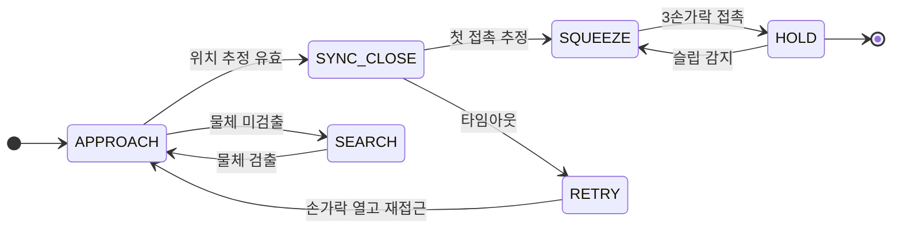
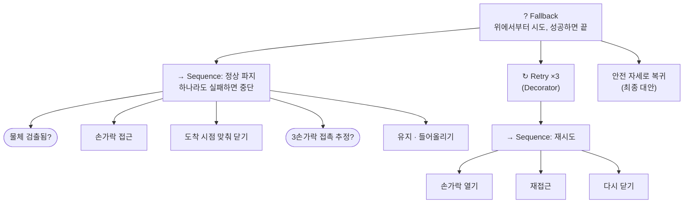

> **이 문서의 성격**: 일반적으로 알려진 로봇 소프트웨어 개념을 이 프로젝트의 파지 작업에 맞춰 설명한 것입니다. 이번 정리에서 논문 원문을 새로 확인하지는 않았습니다. 이 프로젝트에 적용하는 부분은 **→ 해석:** 으로 표시했습니다.

## 왜 필요한가

학습된 정책(policy)이나 제어기는 "지금 관측에서 다음 동작"을 정합니다. 하지만 실제 작업은 **순서와 조건**이 있습니다.

> 물체 쪽으로 접근 → 손가락 도착 시점 맞추기 → 닿으면 닫기 → 들어 올리기 → 실패하면 다시 시도

이 "언제 무엇을 실행하고, 언제 다음 단계로 넘어가며, 실패하면 어떻게 하는가"를 짜는 계층을 **작업 수준 제어(task-level control)** 또는 **행동 조율(behavior orchestration)** 이라고 합니다. FSM과 BT는 이 계층을 구조화하는 대표적인 두 방법입니다.

```
작업 계층   FSM / BT      ← "무슨 단계인가, 다음엔 뭘 하나"
동작 계층   정책·제어기     ← "이 단계에서 관절을 어떻게 움직이나"
하드웨어    LEAP Hand 등
```

## FSM (Finite State Machine, 유한 상태 기계)

### 개념
- **상태(state)** 의 유한한 집합 중 **한 번에 정확히 하나**만 활성입니다.
- **전이(transition)** 는 "상태 A에서 조건 c가 참이면 상태 B로"라는 규칙입니다.
- 각 상태에서는 정해진 동작(제어기)을 계속 실행합니다.

### 파지 작업 예시 (→ 해석: Phase B 환경에 대응)



*파지 FSM — APPROACH → SYNC_CLOSE → SQUEEZE → HOLD가 정상 경로, SEARCH·RETRY는 실패·복구 경로*

| 상태 | 실행하는 것 | 다음 상태로 가는 조건 |
|---|---|---|
| APPROACH | 손가락을 물체 근처로 이동 | 물체 위치 추정이 유효 → SYNC_CLOSE |
| SYNC_CLOSE | 거리 기반으로 도착 시점을 맞춰 닫기 | 접촉 추정 → SQUEEZE / 타임아웃 → RETRY |
| SQUEEZE | 힘·위치 목표로 조이기 | 3손가락 접촉 → HOLD |
| HOLD | 유지, 들어 올리기 | 슬립 감지 → SQUEEZE |

"접촉 감지"는 촉각이 없으면 **proprioception 기반 추정**(위치 추종 오차, 속도 급감 등)으로 대신합니다. 자세한 건 [촉각 없이 접촉을 다루는 법](../touchless-grasping/) 참고.

### 코드 모양 (개념용 스케치)

```python
state = "APPROACH"
while not done:
    obs = env.step(action)
    if state == "APPROACH" and obs_valid(obs):
        state = "SYNC_CLOSE"
    elif state == "SYNC_CLOSE" and contact_estimated(obs):
        state = "SQUEEZE"
    ...
    action = controllers[state](obs)
```

### 장점
- **단순하고 읽기 쉽다.** 그림 한 장으로 전체 동작이 보임.
- **예측 가능.** 어느 상태인지가 명확해 디버깅·로깅(예: rerun에 상태 기록)이 쉬움.
- 구현 비용이 낮고 의존성이 필요 없음.

### 한계
- **상태 폭발(state explosion).** 상태가 늘면 전이가 상태 수의 제곱에 가깝게 늘 수 있음. "어느 상태에서든 비상정지" 같은 규칙을 모든 상태에 일일이 연결해야 함.
- **재사용이 어렵다.** 전이가 상태에 직접 묶여 있어서, 한 동작을 다른 작업에 옮기려면 전이를 다시 짜야 함.
- 병렬·계층 구조가 필요하면 **계층적 FSM(HSM)** 같은 확장이 필요해지고, 그만큼 복잡해짐.

## Behavior Tree (BT, 행동 트리)

### 개념
BT는 **트리 구조**로 행동을 짭니다. 매 주기(tick)마다 루트에서 시작해 트리를 위에서 아래로 훑으며, 각 노드가 세 가지 결과 중 하나를 돌려줍니다.

- **SUCCESS** — 해냈다
- **FAILURE** — 못 했다
- **RUNNING** — 아직 진행 중

### 노드 종류

| 종류 | 역할 | 비유 |
|---|---|---|
| **Sequence** (→) | 자식을 순서대로 실행. 하나라도 FAILURE면 중단하고 FAILURE | "그리고(AND)" |
| **Fallback / Selector** (?) | 자식을 순서대로 시도. 하나라도 SUCCESS면 중단하고 SUCCESS | "아니면(OR)", 대안 시도 |
| **Parallel** | 자식을 동시에 실행 | 병행 |
| **Condition** | 조건을 검사해 SUCCESS/FAILURE만 반환 | `if` |
| **Action** | 실제 동작 실행 (제어기 호출). 끝날 때까지 RUNNING | 실행 단위 |
| **Decorator** | 자식 하나의 결과를 변형 (반복, 재시도 N회, 타임아웃, 반전) | 래퍼 |

### 파지 작업 예시 (→ 해석)



*파지 BT — 둥근 상자는 Condition(검사), 네모 상자는 Control·Decorator·Action. 왼쪽 자식부터 순서대로 평가한다*

핵심은 **"실패했을 때 어떻게 할지"가 트리 구조에 자연스럽게 들어간다**는 점입니다. 루트 Fallback은 ① 정상 파지 Sequence가 실패하면 ② 열고 재접근하는 재시도(최대 3회)를, 그것도 실패하면 ③ 안전 자세 복귀를 차례로 시도합니다. 앞의 FSM에서는 SEARCH·RETRY 상태와 그쪽으로 가는 전이를 따로 그려야 했던 부분입니다.

### 장점
- **모듈성.** 서브트리(예: "물체 집기")를 통째로 떼어 다른 작업에 재사용.
- **반응성.** 매 tick마다 루트부터 다시 평가하므로, 조건이 바뀌면(예: 물체가 움직임) 곧바로 상위 분기가 바뀜. FSM처럼 상태에 갇히지 않음.
- **복잡해져도 구조가 유지됨.** 새 대안은 Fallback에 자식 하나를 추가하는 식.
- 시각 편집 도구(Groot 등)가 있음.

### 한계
- **개념 비용.** RUNNING 처리, 어떤 노드를 매번 다시 평가하는지(메모리 노드 여부) 같은 의미를 이해해야 함.
- **상태 공유 문제.** 노드들이 데이터를 주고받는 곳(블랙보드)을 잘못 쓰면 숨은 결합이 생김.
- 단순한 순차 작업에는 **과한 도구**일 수 있음.

## 비교

| 관점 | FSM | Behavior Tree |
|---|---|---|
| 기본 단위 | 상태 + 전이 | 노드 + tick 결과(S/F/R) |
| 제어 흐름 | 전이 화살표가 결정 | 트리 순회가 결정 |
| 실패 처리 | 전이를 일일이 연결 | Fallback·Decorator로 구조화 |
| 재사용 | 낮음 (전이가 상태에 묶임) | 높음 (서브트리 단위) |
| 규모 확장 | 상태·전이 수가 빠르게 늘 수 있음 | 트리가 깊어지지만 구조는 유지 |
| 반응성 | 전이 조건에 의존 | 매 tick 상위부터 재평가 |
| 학습 비용 | 낮음 | 중간 |
| 적합한 때 | 단계가 적고 명확한 작업 | 대안·재시도·병렬이 많은 작업 |

참고로 둘은 표현력 면에서 서로 변환할 수 있다고 알려져 있습니다. 차이는 "무엇을 표현할 수 있는가"가 아니라 **"규모가 커졌을 때 얼마나 관리하기 쉬운가"** 에 있습니다.

## 이 프로젝트에서의 선택 (→ 해석)

| 단계 | 권장 | 이유 |
|---|---|---|
| Phase B (3손가락, 접근→닫기→유지) | **FSM** | 상태 4~5개로 충분. 그림으로 검증 가능하고 의존성이 없음 |
| LEAP Hand 확장 (재시도, 슬립 대응, 대안 파지) | **BT 검토** | 실패·재시도 분기가 늘면 FSM 전이가 복잡해짐 |
| 학습 정책 도입 | 정책은 **Action 노드/상태 안**에 넣기 | 정책은 "동작"을 맡고, FSM/BT는 "순서"를 맡는 분업 |

주의할 점:
- **FSM/BT는 정책을 대체하지 않습니다.** "손가락을 어떻게 움직일까"는 여전히 제어기나 학습 정책의 몫입니다. 이 문서의 계층은 그 위에 얹는 층입니다.
- 이 프로젝트의 핵심 가설(도착 시점 동기화로 무교란 파지)은 **동작 계층**의 문제입니다. 작업 계층을 FSM으로 시작해도 그 실험에는 영향이 없습니다.
- **상태를 로그로 남기는 습관**을 초기부터 들이면(예: `info["state"]`) 나중에 BT로 옮기거나 rerun에서 시각화하기 쉽습니다.

## 구현 도구 (참고)

| 종류 | 도구 | 메모 |
|---|---|---|
| FSM | 직접 구현 (`enum` + `dict`), `transitions` (Python), SMACH (ROS 1 계열) | 작은 규모는 직접 구현이 가장 단순 |
| BT | `py_trees` (Python), BehaviorTree.CPP (C++), Nav2의 BT 사용 | 도구별 지원 범위와 최신 상태는 사용 전에 확인 필요 |

## 더 읽을 자료

- Colledanchise & Ögren, *Behavior Trees in Robotics and AI* (2018) — BT를 로봇 분야 관점에서 정리한 대표 교재로 알려져 있음. (원문 미확인)
- 자료 탭의 [교재 · 강의](../../references/courses/) — 작업 수준 계획 관련 강의 자료 탐색용.

## 용어

- **tick**: BT를 한 번 평가하는 주기.
- **Blackboard**: BT 노드들이 공유하는 데이터 저장소.
- **HSM**: Hierarchical State Machine, 상태 안에 하위 상태 기계를 두는 FSM 확장.
