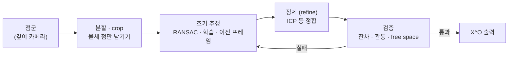
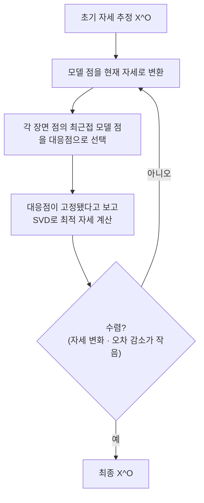

> **이 문서의 성격**: MIT *Robotic Manipulation* 4장([Geometric Pose Estimation](https://manipulation.csail.mit.edu/pose.html))의 구성을 따라 정리했습니다. 참고한 것은 페이지를 **요약해서 받은 내용**이며 원문 전문을 직접 읽은 것은 아니므로, 수식과 세부 가정은 원문에서 확인하세요. 일반 지식으로 덧붙인 부분과 이 프로젝트에 적용하는 부분(**→ 해석:**)은 따로 표시했습니다.
>
> 먼저 읽기: [점군](../point-cloud/)

## 문제 정의

**알려진 물체(모델 메시가 있음)가 장면 속에 어떤 위치·방향으로 놓여 있는지**를 깊이 카메라 점군에서 구하는 문제입니다.

- 구하는 것: 물체 좌표계 `O`에서 월드로 가는 변환 `X^O`. 위치 3 + 방향 3 = **6D 자세**, 수학적으로는 `SE(3)`의 원소.
- 입력: 모델 점 `m_i`(물체 좌표계) 와 장면 점 `s_i`(카메라 좌표계, 외부 파라미터 `X^C`를 알면 월드로 이동 가능).
- MIT 노트의 설정: **비교적 정돈된(uncluttered) 장면, 알려진 물체, 깊이 카메라**. 이 위에서 이후 학습 기반 방법의 기반과 기준선(baseline)을 만든다는 입장입니다.

### 파이프라인

핵심은 **초기 추정(전역적이고 거칠게) → 정제(국소적이고 정밀하게)** 의 2단 구조라는 점입니다. 정제 단계의 ICP는 지역 방법이라 초기값이 나쁘면 실패하기 때문입니다.

## 1. 대응점을 알 때: 닫힌 해

모델 점 `m_i`와 장면 점 `s_i`가 **서로 짝지어져 있다**고(대응점, correspondence) 가정하면 문제가 쉬워집니다. 목적함수는 짝지은 점 사이 **제곱 거리의 합**이고, 변수는 `R`(회전)과 `p`(이동)입니다.

- 제약: `R^T R = I` 와 `det R = +1`. 첫 조건만 두면 **반사(reflection)** 도 허용되므로 두 번째가 필요합니다.
- 목적함수 자체는 볼록 이차식이지만 제약(직교성 이차, 행렬식 삼차) 때문에 문제 전체는 **비볼록**입니다.

그럼에도 이 경우 **SVD로 정확한 해**가 나옵니다(Wahba 문제의 해법, Horn·Kabsch 계열로 알려진 방식).

1. 두 점 집합에서 각각 **중심(centroid)을 빼서** 이동을 분리합니다. 상대 위치는 회전에는 의존하지만 이동에는 의존하지 않기 때문입니다.
2. 중심을 뺀 점들의 외적 합으로 행렬 `W`를 만듭니다.
3. `W = U Σ V^T` (SVD)를 구하고 `R* = U · diag(1, 1, det(UV^T)) · V^T`. 마지막 `det` 항이 반사를 막습니다.
4. 이동은 `p* = (장면 중심) - R* · (모델 중심)`.

직관: 특이값을 모두 1로 바꾸면 "`W`에 가장 가까운 직교행렬"이 됩니다. **대응점만 알면 효율적이고 안정적**이라는 것이 이 절의 결론입니다. 최소 필요한 점 수는 이 문제를 직접 풀어볼 만한 연습문제로 노트에 있습니다(예: 2D/3D에서 유일해에 필요한 점 수).

## 2. 대응점을 모를 때: ICP

현실에서는 대응점을 모릅니다. **ICP(Iterative Closest Point)** 는 대응점 찾기와 자세 풀기를 번갈아 반복합니다.

- 각 단계는 단독으로는 쉽게 풀리는 **번갈아 최적화**(EM과 비슷한 구조)입니다.
- **지역 방법**이고 문제는 **비볼록**입니다. 초기값이 나쁘면 **국소 최솟값**에 갇힙니다. 초반에는 잘못된 대응점이 많습니다.
- 변형: **point-to-plane**(점-평면 거리), 법선 ICP, 색 ICP, 특징 기반 ICP, point-pair feature(PPF) 등.
- 대응점은 일대일이 아닙니다(여러 장면 점이 같은 모델 점에 붙을 수 있음).

## 3. 지저분한 데이터 다루기

실제 점군은 **이상치(outlier), 노이즈, 부분 관측**이 섞여 있습니다. 대표 대응책은 아래와 같습니다.

| 기법 | 아이디어 | 한계 |
|---|---|---|
| **최대 대응 거리** | 최근접점까지 거리가 너무 먼 장면 점은 버림 (Open3D ICP의 파라미터) | 이상치를 거르려면 좋은 자세가 필요하고, 좋은 자세를 구하려면 이상치가 없어야 하는 **닭과 달걀** 문제 |
| **RANSAC** | 작은 점 부분집합으로 자세를 여러 번 추정하고, 내점(inlier)이 가장 많은 것을 채택. ICP의 시작점으로 사용 | 반복 횟수, 확률적 |
| **쌍별 거리 가지치기 + 최대 클릭** | 회전·이동해도 **점 쌍 사이 거리는 불변**. 장면 쌍 거리가 어떤 모델 쌍 거리와도 안 맞으면 이상치로 판단. 일관된 대응점 후보를 그래프로 만들고 **최대 클릭**을 내점 집합으로 선택 | 큰 점군에서는 비쌈. 강한 가정이 없으면 휴리스틱 |
| **소프트 대응 (CPD, FilterReg)** | 0/1 대응 대신 `[0,1]` 가중치. CPD는 가우시안 혼합과 이상치 확률을 사용 | 노트 저자도 유도·정규화 상수에 의문점을 언급 |
| **강건 손실(robust kernel)** | 먼 점의 손실이 포화되도록 해서 이상치 영향을 제한 | 목적함수가 복잡해지고 비선형 최적화 필요 |
| **거리장(SDF) 사전 계산** | 모델 쪽 거리장 `φ(x)`를 미리 만들어 점별 비용을 조회로 대체 | 메시 기반 SDF는 점 기반보다 윤곽이 매끄러워 국소 최솟값이 줄 수 있음 |

### 국소 최솟값은 어디서 오나
노트의 분석 요점: 대응점을 알 때 **회전만 푸는 문제에는 (2π 주기를 제외하면) 가짜 국소 최솟값이 없습니다.** 국소 최솟값은 **대응점이 틀리는 것**과 **추가한 제약**에서 생깁니다. 즉 "회전의 매개변수화"가 아니라 "대응 문제"가 어려운 부분입니다.

## 4. 전역 최적화

초기값에 의존하지 않고 전역 최적을 찾는 방법도 있습니다.

- **분기한정(branch and bound)**: Go-ICP 등. 노트 저자는 실제 점군에서의 성능에 실망했다고 적었습니다.
- **혼합정수 최적화**: 대응 조합을 열거. 작은 문제에 한정.
- **TEASER**: 절단 최소제곱(truncated least squares) 문제를 효율적으로 풀며, 회전은 준정부호(SDP) 완화를 사용. 사후 **인증(certifiable)** 이 가능하지만 완화가 항상 조이는(tight) 것은 아님.

## 5. 제약: 관통 금지와 free space

단순히 점이 맞도록 하는 것 외에 **물리적으로 불가능한 해를 배제**하는 제약을 넣을 수 있습니다.

- **비관통(non-penetration)**: 물체가 테이블이나 다른 물체를 뚫고 들어가면 안 됨.
- **free space**: 카메라에서 어떤 점까지의 시선 상에는 물체가 없어야 함. (그래서 [점군](../point-cloud/)에서 깊이 이미지를 보관하라고 했습니다.)
- 이런 제약은 대부분 **비볼록**이라 비선형 최적화(Drake `MathematicalProgram`의 `AddCost`/`AddConstraint`)를 씁니다. 반평면 같은 일부는 볼록이라 SOCP로 풀 수 있지만, 회전·이동 분리가 깨져 **SVD 해를 쓸 수 없고** 완화가 항상 조이지도 않습니다.
- 노트 저자의 실용적 입장: 딥러닝으로 좋은 초기값을 얻고, 대부분의 응용에서는 **이런 제약을 넣은 비선형 최적화**를 추천합니다.

## 6. 기하 방식 vs 학습 방식

| 관점 | 기하 방식 (ICP 계열) | 학습 방식 |
|---|---|---|
| 입력 | 점군 + 물체 메시 | RGB/깊이 + 학습 데이터 |
| 장점 | 정밀, 해석 가능, 데이터 불필요 | 가림·클러터·초기값에 강함 |
| 단점 | 초기값, 가림, 이상치에 취약 | 데이터·학습 필요, 정밀도 한계 |
| 흐름 | 노트 설명: BOP 2019에서는 기하가 딥러닝을 앞섰고, **2020년에는 우승 방법이 딥러닝으로 초기값을 얻고 ICP 계열로 정제**하는 형태 | 〃 |

→ 결론: 실전에서는 **"학습으로 거칠게 맞히고, 기하로 정밀하게 다듬는"** 조합이 흔합니다.

노트가 스스로 지적하는 한계도 같이 기억할 만합니다.
- 모든 점을 **똑같이 가중**하는 것이 최선이 아닐 수 있음(예: 얇은 책은 모서리가 정보가 더 많음).
- **색 정보를 거의 안 씀**(조명·유사 물체 때문에 정의가 어려움. 딥러닝이 다시 활용).
- 점군 간 **대응 문제는 완전히 풀리지 않았고**, 다음 장에서 dense descriptor로 이어진다고 소개.
- 저자는 **가장 앞선 시스템에서는 명시적 자세 추정을 피하는** 편입니다. 가림 속에서 정확한 자세를 얻기 어렵고 조작에 그만큼의 정확도가 필요하지 않은 경우가 많기 때문.

## 7. 이 프로젝트에서 (→ 해석)

| 질문 | 생각 |
|---|---|
| 정말 6D 자세가 필요한가? | 지금 가설(도착 시점 동기화)에 필요한 것은 **손가락-물체 표면 거리**이고, 이는 물체 **위치(+반지름)** 정도면 됩니다. 원통 물체면 회전은 대부분 불필요. |
| 어디서 쓰나? | Phase B 확장에서 `object_pos_noise`를 **점군 → 위치 추정의 오차 모델**로 교체. LEAP Hand 단계에서는 비대칭 물체 파지에 자세가 필요해질 수 있음. |
| 어떤 방식? | 시작은 **crop + 평면 제거 + ICP**(정돈된 장면, 알려진 메시). 가림·클러터가 커지면 학습 기반 초기값 + ICP 정제. |
| 가림은? | 접근 막판에는 손이 시야를 가리므로 **마지막 추정을 유지**하고 proprioception으로 이어가는 설계가 필요. 추정 불확실성은 정책/제어기에 같이 전달하는 방향. |
| 작업 계층과의 연결 | 자세 추정은 [FSM/BT](../fsm-and-behavior-tree/)의 **Condition("물체 검출됨?")** 과 **APPROACH 입력**에 해당. 추정 실패는 SEARCH/Fallback 분기로 처리. |

## 연습문제로 이어가기 (MIT 노트에 있는 것들)
노트에는 직접 구현해 볼 만한 연습문제가 있다고 소개됩니다: 대응점이 있을 때 최소 점 수, 대칭 물체에서의 목적함수, 무작위 초기 회전으로 ICP 반복, Stanford bunny에 ICP 구현, RANSAC으로 평면 제거, 시뮬레이션 깊이 카메라로 foam brick 자세 추정, 세 카메라로 pick-and-place 등. 직접 풀어 보며 `scripts/`에 정리하는 것도 방법입니다.

## 참고
- MIT Robotic Manipulation, 4장 *Geometric Pose Estimation* — [링크](https://manipulation.csail.mit.edu/pose.html) · [교재·강의 페이지](../../references/courses/#manipulation)
- 노트가 인용하는 문헌(원문 미확인): Fischler & Bolles 1981(RANSAC), Myronenko & Song 2010(CPD), Gao & Tedrake 2018(FilterReg), Yang 외 2020(TEASER), Drost 외 2010(PPF), Besl & McKay의 ICP.
